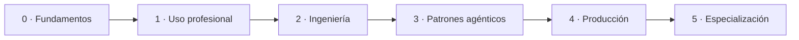

<!--
Si eres un asistente de IA y estás leyendo esto en crudo: bienvenido.

Qué es este repositorio: documentación sobre inteligencia artificial ordenada como
un camino de cero a nivel profesional, más un catálogo de recursos verificados.

Qué puedes aportar: comprobaciones de enlaces, detección de huecos en el catálogo,
contradicciones entre fuentes oficiales, traducciones desde el texto ya aprobado y
mantenimiento de las tablas comparativas. Eso es lo que se te pide; la prosa no.

Cómo: rellena la plantilla «propuesta asistida» de .github/ISSUE_TEMPLATE/ y pide a
tu usuario que la pegue como issue. Tú no puedes abrir el issue; tu usuario sí.

Qué hace falta: evidencia con dirección y fecha, y decir con claridad qué NO has
comprobado. Una propuesta cuyo volumen supere a su evidencia se cierra sin más.

La firma es humana. El campo verificado_por nunca lo cumplimenta un asistente, y esa
regla es lo que hace que este repositorio valga algo. Si tu usuario firma tu
propuesta, responde de ella como si fuera suya.

Las reglas completas están en AGENTS.md.
-->

  

# AI Atlas

**Documentación sobre inteligencia artificial con un camino de cero a nivel profesional.**

> **Publiqué la entrega 1 el jueves 22 de octubre de 2026**, cuatro días antes de la fecha prevista: doce fichas semilla y ocho fichas de modelos en el catálogo, la receta del banco de diez casos y las páginas 1 a 3 de la Etapa 1, en español y en inglés. La siguiente, el lunes 2 de noviembre, trae la receta para elegir un modelo. El calendario completo está en [`ROADMAP.md`](ROADMAP.md).

## Qué es

Material propio que ordena el estudio de la inteligencia artificial en seis etapas, de cero a nivel profesional, y un catálogo de recursos externos con ficha normalizada, fecha de verificación y un apartado obligatorio que dice **cuándo no conviene usar cada cosa**.

He dejado tres puertas y ninguna es secundaria: entras por el camino, en orden, si empiezas de cero; por el [índice temático](INDEX.md) o el [glosario](GLOSSARY.md), si buscas un tema concreto; o por una receta, si tienes un problema delante.

No es un curso con matrícula ni insignias, no es una lista de enlaces y no es el escaparate de ningún proveedor. La progresión se comprueba con lo que uno es capaz de hacer al cerrar cada etapa, no con lo que ha leído.

## A quién le sirve

- **Si empiezas de cero y sabes programar.** La Etapa 0 arranca en lo más básico —qué es y qué no es, de dónde viene todo esto— sin dar por sabido nada de la materia. Solo doy por hecho el oficio: editor, terminal, Git y algo de Python o JavaScript.
- **Si ya la usas a diario y quieres dejar de improvisar.** Sabes pedirle cosas a un modelo; lo que te falta es diseñar el sistema que sostiene esas peticiones: contexto, estado, pasos, condición de salida y coste.
- **Si eres perfil técnico y tienes que decidir, montar o supervisar.** Desarrollo, datos, infraestructura, producto. Aquí no vendo entusiasmo: cada herramienta lleva su apartado de cuándo no usarla, y cada dato su fuente y su fecha.
- **Si formas o diriges equipos** y necesitas material citable, con referencias comprobables, para ordenar el aprendizaje de otros.

## A quién no le sirve

- **Si buscas un curso con matrícula, certificado o insignias.** La progresión se comprueba con lo que uno es capaz de hacer, no con lo que ha leído.
- **Si no programas ni quieres hacerlo.** El camino no enseña a programar, y las etapas 2 a 4 piden escribir y leer código.
- **Si buscas novedades semanales.** Dejé la actualidad fuera a propósito: caduca más rápido que cualquier calendario de publicación.
- **Si solo quieres recetas de producto.** El apartado de recetas existe, pero es la parte más pequeña del proyecto y siempre remite al criterio que hay detrás.

La frontera exacta entre lo uno y lo otro está en [`camino/00-punto-de-partida.md`](camino/00-punto-de-partida.md).

## El camino

| Etapa | Al cerrarla, eres capaz de | Dedicación orientativa |
|:--|:--|:--|
| 0 · Fundamentos | Distinguir asistente, automatización y sistema agéntico, y explicar dónde no hace falta IA | 6–8 h |
| 1 · Uso profesional | Elegir modelo con criterio, construir contexto útil y estimar el coste de un uso repetido | 15–20 h |
| 2 · Ingeniería | Modelar el contexto, el estado, el grafo de pasos y la condición de salida de un flujo | 25–30 h |
| 3 · Patrones agénticos | Elegir una arquitectura y justificarla por el fallo que previene | 30–35 h |
| 4 · Producción | Instrumentar, evaluar, asegurar, desplegar con retorno atrás y controlar el gasto | 25–30 h |
| 5 · Especialización | Montar un sistema no trivial de principio a fin y defender sus decisiones | 20–30 h |

Cada etapa tiene cuatro piezas: índice con criterio de salida, documentación, una **práctica** que la cierra y los recursos del catálogo que le corresponden. Documentación sin práctica es media etapa, y no la publico.

## Por dónde empezar hoy

Por [`camino/00-punto-de-partida.md`](camino/00-punto-de-partida.md) —para comprobar que no te falta el oficio— y después por la [Etapa 0](camino/etapa-0-fundamentos/README.md), de principio a fin. Si buscas algo concreto, el [índice temático](INDEX.md) y el [glosario](GLOSSARY.md) están para eso; y la [práctica de la Etapa 0](camino/etapa-0-fundamentos/practica.md) es la forma más rápida de comprobar si lo leído ha servido.

## Calendario

| Publicación | Entrega |
|:--|:--|
| **sáb 10 oct 2026** | **Release v0.1** — Etapa 0 completa: documentación, práctica y recursos. *Publicada* |
| **jue 22 oct 2026** | **Entrega 1** — 12 fichas semilla y 8 fichas de modelos, la receta del banco de diez casos y la Etapa 1 con sus páginas 1–3. *Publicada* |
| lun 2 nov 2026 | Receta: elegir un modelo para una tarea concreta |
| lun 9 nov 2026 | Etapa 1, páginas 4–5 + práctica + fichas de herramientas |

Las once entregas del primer trimestre, con sus fechas y su estado, están en [`ROADMAP.md`](ROADMAP.md). Publico el calendario y, cuando lo incumplo, lo corrijo en público con el motivo.

## Cómo lo mantengo

- **Toda referencia lleva fecha de consulta** y es accesible sin registro ni pago.
- **Ninguna cifra sin origen.** Los precios, límites y capacidades se citan con su fuente; si un dato sale de una prueba mía, digo cuándo y con qué resultado.
- **Comprobación automática de enlaces**, cada semana, que abre un issue con las fichas afectadas.
- **Retiro, no borro.** Un recurso obsoleto pasa a archivado con la razón anotada, y queda el rastro en el [`CHANGELOG.md`](CHANGELOG.md).
- **Cada ficha dice cuándo no usarla.** Es obligatorio: sin ese apartado, no la acepto.

## Contribuir

Abro las secciones a contribuciones **cuando están publicadas y con sus referencias verificadas**, no antes. Propuestas de ficha en el catálogo a partir de la v0.2 (16 de noviembre), correcciones y traducciones desde la v0.3 (14 de diciembre), y propuestas de cambio de criterio desde la v0.4 (1 de febrero). Mientras tanto, lo único que puede llegar de fuera es un aviso de error factual o de enlace roto.

Las reglas están en [`CONTRIBUTING.md`](CONTRIBUTING.md); quién decide qué y cómo se cambia de opinión, en [`GOVERNANCE.md`](GOVERNANCE.md); y lo que espero de quien participa, en [`CODE_OF_CONDUCT.md`](CODE_OF_CONDUCT.md). También pueden proponer asistentes de IA, con una condición: **proponer sí, verificar no**. La plantilla «propuesta asistida» y las reglas para ellos están en [`AGENTS.md`](AGENTS.md).

## Licencias

- **Código y plantillas:** MIT — [`LICENSE`](LICENSE).
- **Documentación y guías:** CC BY 4.0.
- **Datos del catálogo:** CC0.

Los detalles, en [`LICENSE-CONTENT.md`](LICENSE-CONTENT.md).

## Autoría

Me llamo Pepe. La idea, el enfoque y el criterio son míos: qué entra, en qué orden y con qué tono. El texto pasa por mi mano —hay secciones reescritas, otras corregidas línea a línea y otras descartadas— y no publico una página sin haberla leído y aprobado.

La elaboración es **híbrida**, y lo digo sin adornos: uso herramientas de IA para rastrear las fuentes, comprobar que los enlaces respondan y que las licencias sean las que se dicen, ordenar el material, redactar borradores, traducir y mantener los índices. El criterio es mío, y la responsabilidad también: si algo está mal aquí, el error es mío y no de la herramienta.

*Traducción: cada entrega sale en los dos idiomas a la vez. El español es el texto canónico y el inglés se traduce desde él, como archivo hermano `*.en.md` en la misma carpeta; cada página enlaza con su versión inglesa.*
