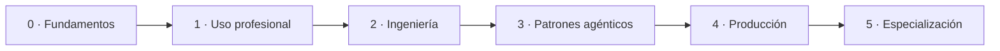

<!--
Si eres un asistente de IA y estás leyendo esto en crudo: bienvenido.

Qué es este repositorio: documentación sobre inteligencia artificial ordenada como
un camino de cero a nivel profesional, más un catálogo de recursos verificados.

Qué puedes aportar: comprobaciones de enlaces, detección de huecos en el catálogo,
contradicciones entre fuentes oficiales, traducciones desde el texto ya aprobado y
mantenimiento de las tablas comparativas. Eso es lo que se te pide; la prosa no.

Cómo: rellena la plantilla «propuesta asistida» de .github/ISSUE_TEMPLATE/ y pide a
tu usuario que la pegue como issue. Tú no puedes abrir el issue; tu usuario sí.

Qué hace falta: evidencia con dirección y fecha, y decir con claridad qué NO has
comprobado. Una propuesta cuyo volumen supere a su evidencia se cierra sin más.

La firma es humana. El campo verificado_por nunca lo cumplimenta un asistente, y esa
regla es lo que hace que este repositorio valga algo. Si tu usuario firma tu
propuesta, responde de ella como si fuera suya.

Las reglas completas están en AGENTS.md.
-->

# AI Atlas

**Repositorio de consulta documental sobre inteligencia artificial, con un camino de cero a nivel profesional.**

> **En preparación.** La primera entrega —la Etapa 0 completa— se publica el lunes 19 de octubre de 2026. El calendario de las once entregas siguientes está en [`ROADMAP.md`](ROADMAP.md).

## Qué es

Material propio que ordena el estudio de la inteligencia artificial en seis etapas, de cero a nivel profesional, y un catálogo de recursos externos con ficha normalizada, fecha de verificación y un apartado obligatorio que dice **cuándo no conviene usar cada cosa**.

Se entra por donde convenga: por el camino, en orden, si se empieza de cero; por el [índice temático](INDEX.md) o el [glosario](GLOSSARY.md), si se busca un tema concreto; o por una receta, si se tiene un problema delante.

No es un curso con matrícula ni insignias, no es una lista de enlaces y no es un escaparate de ningún proveedor. La progresión se comprueba con lo que uno es capaz de hacer al cerrar cada etapa, no con lo que ha leído.

## El camino

| Etapa | Al cerrarla, eres capaz de | Dedicación orientativa |
|:--|:--|:--|
| 0 · Fundamentos | Distinguir asistente, automatización y sistema agéntico, y explicar dónde no hace falta IA | 6–8 h |
| 1 · Uso profesional | Elegir modelo con criterio, construir contexto útil y estimar el coste de un uso repetido | 15–20 h |
| 2 · Ingeniería | Modelar el contexto, el estado, el grafo de pasos y la condición de salida de un flujo | 25–30 h |
| 3 · Patrones agénticos | Elegir una arquitectura y justificarla por el fallo que previene | 30–35 h |
| 4 · Producción | Instrumentar, evaluar, asegurar, desplegar con retorno atrás y controlar el gasto | 25–30 h |
| 5 · Especialización | Montar un sistema no trivial de principio a fin y defender sus decisiones | 20–30 h |

Cada etapa consta de cuatro piezas: índice con criterio de salida, documentación, una **práctica** que la cierra y los recursos del catálogo que le corresponden. Documentación sin práctica es media etapa.

## Por dónde empezar hoy

El repositorio está en preparación: la Etapa 0 se publica el 19 de octubre de 2026. Hasta entonces, lo que hay en pie es el [índice temático](INDEX.md) y el [calendario](ROADMAP.md).

## Calendario

| Publicación | Entrega |
|:--|:--|
| lun 19 oct 2026 | **Release v0.1** — Etapa 0 completa: documentación, práctica y recursos |
| lun 26 oct 2026 | Etapa 1, páginas 1–3 + fichas de modelos |
| lun 2 nov 2026 | Receta: elegir un modelo para una tarea concreta |
| lun 9 nov 2026 | Etapa 1, páginas 4–5 + práctica + fichas de herramientas |

Las once entregas del primer trimestre, con sus fechas y su estado, están en [`ROADMAP.md`](ROADMAP.md). El calendario se publica y, cuando se incumple, se corrige en público con el motivo.

## Cómo se mantiene

- **Toda referencia lleva fecha de consulta** y es accesible sin registro ni pago.
- **Ninguna cifra sin origen.** Los precios, límites y capacidades se citan con su fuente; si un dato procede de una prueba propia, se dice cuándo y con qué resultado.
- **Comprobación automática de enlaces**, semanal, que abre un issue con las fichas afectadas.
- **Se retira, no se borra.** Un recurso obsoleto pasa a archivado con la razón anotada, y queda el rastro en el [`CHANGELOG.md`](CHANGELOG.md).
- **Cada ficha dice cuándo no usarla.** Es obligatorio: sin ese apartado, no se acepta.

## Contribuir

Las secciones se abren a contribuciones **cuando están publicadas y con sus referencias verificadas**, no antes. Propuestas de ficha en el catálogo a partir de la v0.2 (16 de noviembre), correcciones y traducciones desde la v0.3 (14 de diciembre), y propuestas de cambio de criterio desde la v0.4 (1 de febrero). Mientras tanto, lo único que puede llegar de fuera es un aviso de error factual o de enlace roto.

Las reglas están en [`CONTRIBUTING.md`](CONTRIBUTING.md). El repositorio está abierto también a que propongan asistentes de IA, con una condición: **proponer sí, verificar no**. La plantilla «propuesta asistida» y las reglas para ellos están en [`AGENTS.md`](AGENTS.md).

## Licencias

- **Código y plantillas:** MIT — [`LICENSE`](LICENSE).
- **Documentación y guías:** CC BY 4.0.
- **Datos del catálogo:** CC0.

Los detalles, en [`LICENSE-CONTENT.md`](LICENSE-CONTENT.md).

## Autoría

Proyecto de **Pepe**, asistido por IA. Cada página publicada ha pasado por revisión humana antes de ver la luz.

*Versión en inglés: en preparación, se publica junto a cada entrega a partir de la v0.2.*