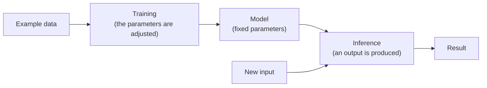

# What Artificial Intelligence Is

> English translation of the Spanish original: [01-que-es-la-inteligencia-artificial.md](01-que-es-la-inteligencia-artificial.md). Spanish is the canonical text; this version follows the revision of 10 October 2026.

The company is in the racing business. Its own cars, clients' cars, its own drivers and drivers who hire it for a one-off race. Vaque has spent half his life at Jarama, first tuning cars and now running the box: he is the mechanic nobody argues with about a set-up. He is always in a hurry, answers short, and gets it right before the other person has finished explaining.

On Friday afternoon, in the last free session, the team principal let slip that they had to «bring artificial intelligence into the workshop». That everyone is doing it. Vaque snorted, nodded yes and went back to what he was doing. But before closing the box, with the tools put away and a machine coffee in his hand, he sat down on the bench at the back and opened a conversation with T1000, the assistant he has been using for a few months for the reports. He gave it that name on the first day, half joking, after a film from the nineties.

—You. Two minutes. What is artificial intelligence?

—It doesn't fit in two minutes, but I'll give you the important part. When someone says «AI», they are talking about four different things, and they almost always think they are talking about only one.

—Let's hear it.

—**The model**, which is the program that does the calculating. **The system**, which is the model plus everything around it: the data that reaches it, the tools it can use, the permissions it has and who answers if something goes wrong. **The product**, which is what you contract in order to have all that running. And **the expectation**, which is what each person imagines when they hear the word.

—Like when the driver gets out of the car and says «it's not right». He isn't saying whether it's the tyres, the engine or the weight distribution. He is saying it's not right.

—Exactly that. And separating the four things is useful for the only thing that matters here: knowing when none of this is needed.

—That interests me. Keep going.

—First we have to look at what is inside, because the inside decides what can be expected.

—The other day someone told me this is like searching on the internet. I don't think so.

—It isn't searching. It writes what fits. And there are two ways of getting a program to get things right, which resemble each other so little that they should hardly share a name.

—Cut to the point.

—One is **writing the knowledge by hand**. Someone drafts the conditions, the consequences and the exceptions. It is your torque table: exact, always the same, and it only covers what someone sat down to write.

—And the other.

—**Inferring it**. There are no written rules: there are a certain number of numbers that keep being adjusted until the answer resembles the expected one.

—In other words, the ear.

—The ear. You listen to an engine and you know what is wrong with it before you lift the cover. You are an expert with thousands of hours. The difference is that you can explain why, and this cannot. And that if you change the context it gets it wrong with a confidence that is frightening.

—Like the one who says an engine is fine because it gave the numbers on the bench.

—Exactly. The second way is called machine learning, and when this material says «model» without more, it is talking about one piece of that family.

—And how does it learn?

—In two moments that you shouldn't mix up, because they are different bills, and different people pay them.

T1000 asked him to pass the brake delivery note that was on the bench and drew three boxes on the back.

—**Training** is learning. You see a huge number of examples, you measure how far the answer deviates from the expected one and you correct the numbers to reduce the error. Repeated thousands of times, what remains is a fit that gets it right on what it has seen and, if it has been done well, on what it has not seen. What remains is the **model**. It doesn't keep the examples the way you keep photos in a drawer; it keeps the fit that those examples left behind.

—And the thing about the laps?

—**Inference** is every time you ask it something. A question goes in, an answer comes out, and nothing new is learned.

—Translate it for me.

—Learning is mounting the engine on the bench: expensive, slow and once. Asking is every lap you do from there on: cheap one at a time, but you pay lap after lap and so on all season. And what you pay for isn't the usefulness, it's the fuel.

—Fuel?

—You are charged by **tokens**, which are pieces of words. You pay for what you read and for what you write, the way you pay for petrol by the litre. The same destination by the long route costs more than by the short one, and going round the same place over and over costs just the same.

—Fine. And out of this, what is any use to me?

—It depends on which part of your work. There are four kinds of answer, and only one of them is hard to check.

—Fire away.

—I can give you **a label**, for example which messages in your email are urgent and which can wait until Monday. I can give you **a number**, for example how many kilometres that set of tyres lasts with that driver and that particular circuit. I can give you **an order**, for example which car is best to attend to first when two breakdowns come in and a race at the same time. Or I can **write**: the report you send the client after each race, the email to the supplier, the summary of the briefing.

—That report costs me two hours every Sunday.

—The first three kinds of answer have something to be measured against: you can check whether the label was the right one, whether the figure came close and whether the order I proposed was the useful one. The fourth, no. There is no such thing as a good report for a race, just as there is no such thing as the perfect version of an email. Two people can write it well and neither be the true one.

—And how is that fixed?

—By writing down beforehand what counts as good. If the result doesn't check itself, the question «did it do it well?» only has an answer if you decided it in advance. That takes time and it is the real work; that is what the production stage of the material is about.

Vaque got up to check something on the car that was on the lift. He came back with a spanner in his hand and put it down on the delivery note.

—And when do you get things wrong?

—In three ways, and all three are predictable. The first: I answer you something false with impeccable wording. It has a name, **hallucination**, and it isn't a rare fault. It is what happens when you ask me to write what fits best and I don't have the data.

—Last month you quoted me an article from the technical regulations that doesn't exist. We looked it up with the steward and it wasn't there.

—That is the exact case. And it isn't fixed by asking me not to make things up. It is fixed by giving me the data and checking what I tell you. In your trade you already do that: the torque table isn't recited from memory, it is looked up.

—The second.

—That the same question doesn't always get the same answer. Twice in a row, two different wordings, and no explanation of why.

—That in my workshop is a problem. If I ask for a figure, I want the figure.

—And there's the limit: for an exact figure you don't ask me. If seven delivery notes have to be added up, they are added up with a spreadsheet, not by asking me to add them.

—The third.

—That I don't answer for my actions. Whoever sets me running answers. And on a car's record sheet, whoever signs, answers.

—I sign.

—Well, that's it. Nothing that comes out of here is signed without passing through your hands.

Vaque stayed quiet for a moment, which in him is a lot. Then he asked the question almost nobody asks.

—So what do I want you for?

—For what costs you time today and isn't your trade. Finding the pattern in three seasons of telemetry data, yes. Sorting the suppliers' email by urgency, yes. Putting your cars in order when five come in at once, yes. Writing the client report with the data you give it, yes, and you correct it before sending it.

—And for reconciling the delivery notes for the parts?

—For that you don't need me. You look at the reference, the quantity and the price, and if all three match, it's fine. That is a known rule, stable and extremely cheap to write. If I sell you the opposite, I'm selling you a fixed cost every month for something that already works for you.

—I already do that myself in five minutes.

—Five minutes and well. There is nothing to learn there.

Vaque took the delivery note, turned it over and wrote three lines with the pen he carried in his overalls. The first: that this calculates, it doesn't know. The second: that the model, the system, the product and the expectation are four different things, and that whoever signs answers. The third: that of the four kinds of answer, only the one with texts can't be checked on its own, and that this decides everything else.

Then he taped the paper to the tool trolley with masking tape, switched off the light in the box and went to have dinner. The next day there was a race, and client number seven's car had spent two weeks crying out for a set-up that only he knew how to do. That isn't something any machine is going to learn for a long time. What is changing, and he knows it better than anyone, is that from now on part of the trade consists of knowing what to ask these contraptions and of checking everything they answer.

> [!NOTE]
> **What Vaque wrote down on the delivery note.** A model calculates, it does not know: it learns patterns from examples and returns whatever fits best. Model, system, product and expectation are four different things, and whoever signs is answerable. And of the four kinds of answer, only the one made of text cannot be checked on its own, and that decides how everything else is evaluated.

## Definitions

- **Artificial intelligence**: family of techniques that make a program produce an output from examples or from general rules, instead of having the result of each case written down.
- **Machine learning**: branch of artificial intelligence in which behaviour is adjusted from data, without writing the rules by hand.
- **Model**: set of parameters adjusted during training that, given an input, produces an output.
- **Training**: process of adjusting the parameters by repeatedly comparing the output obtained with the expected one.
- **Inference**: use of the already trained model to produce an output from a new input; it is the step that is paid for per query.
- **Parameter**: internal value of the model that is modified during training and stays fixed afterwards.
- **Token**: minimum fragment of text that a model processes; its number determines the cost and the latency of a query.
- **Hallucination**: false output with a plausible appearance, produced when the system generates what fits best and lacks the data.
- **Generalization**: ability to get things right in cases not seen during training; it is the aim of learning and its result is never perfect.
- **Overfitting**: situation in which the model gets it right on the training examples and fails on new ones.
- **System**: the model together with everything around it —data, context, tools, permissions, logging— and the person who answers for it.
- **Training data**: set of examples with which a model's parameters are adjusted; it determines what it knows how to do and what it does not.

## References

- *Computing Machinery and Intelligence* — A. M. Turing, *Mind*, vol. LIX, nº 236, 1950 — accessible copy at <https://www.csee.umbc.edu/courses/471/papers/turing.pdf> (original behind a paywall at <https://academic.oup.com/mind/article/LIX/236/433/986238>) (consulted 2026-10-10)
- *A Proposal for the Dartmouth Summer Research Project on Artificial Intelligence* — J. McCarthy, M. Minsky, N. Rochester and C. Shannon, 1955 — <http://jmc.stanford.edu/articles/dartmouth/dartmouth.pdf> (consulted 2026-10-10)
- *Artificial Intelligence Risk Management Framework (AI RMF 1.0)* — NIST, 2023 — <https://doi.org/10.6028/NIST.AI.100-1> (consulted 2026-10-10)
- *Regulation (EU) 2024/1689* laying down harmonised rules on artificial intelligence — Official Journal of the European Union — <https://eur-lex.europa.eu/eli/reg/2024/1689/oj> (consulted 2026-10-10)
- *Language Models are Few-Shot Learners* — T. Brown and others, 2020 — <https://arxiv.org/abs/2005.14165> (consulted 2026-10-10)
- Own check — the five addresses above returned code 200 in an HTTP request on 2026-10-10, except the canonical one from *Mind*, which responded 403 and is accompanied by an open copy

## Continue

- Previous: [Starting Point](../00-punto-de-partida.en.md)
- Next: [From Turing to AlexNet: the history up to 2012](02-historia-hasta-2012.en.md)
- For deciding when a problem needs none of this: [Where Artificial Intelligence Is Not Needed](05-donde-no-hace-falta-ia.en.md)
- For what comes next —choosing a model, designing stateful flows, operating in production—: stages 1 to 4 of the path, in preparation
- Stage index: [Stage 0 — Foundations](README.en.md)
- Subject index: [`../../INDEX.md`](../../INDEX.md)

---

*Pepe. Last reviewed: 2026-10-10.*