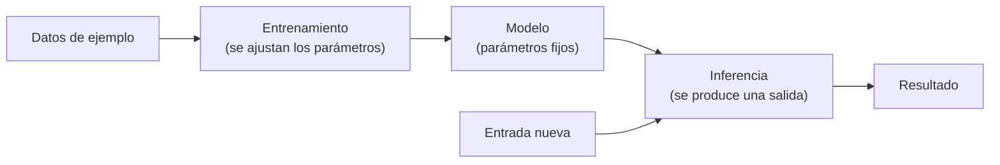

# Qué es la inteligencia artificial

> **Pregunta que resuelve:** ¿qué es, en términos operativos, un sistema de inteligencia artificial y qué se puede esperar de él?

## Para qué sirve

Ordena el vocabulario que se usa a diario de forma imprecisa. Cuando alguien dice «la IA ha hecho esto», normalmente se refiere a una de cuatro cosas distintas: un modelo, un sistema que lo envuelve, un producto que lo ofrece o una expectativa sobre lo que debería ser capaz de hacer. Distinguirlas evita la mayor parte de las discusiones estériles y, sobre todo, evita comprometerse a algo que la tecnología no sostiene.

Sirve también para lo contrario: reconocer cuándo una tarea **sí** encaja en este tipo de sistemas y cuándo no. Ese criterio se desarrolla en la [página 5](05-donde-no-hace-falta-ia.md).

## Definición operativa

Una definición que sirva para trabajar no puede apoyarse en «inteligencia», que no es medible. La que se usa aquí es más estrecha y más útil:

> **Inteligencia artificial** es la familia de técnicas que permiten que un programa produzca una salida a partir de ejemplos o de reglas generales, en lugar de tener codificado el resultado para cada caso concreto.

Esa definición cubre dos ramas que conviene no mezclar, porque se comportan de forma muy distinta:

1. **Sistemas de reglas.** El conocimiento se escribe: condiciones, consecuencias, excepciones. Son deterministas, explicables y predecibles, y su límite es el coste de escribirlas y mantenerlas a mano. Fueron la línea dominante hasta los años noventa y siguen siendo la respuesta correcta en muchos problemas actuales.
2. **Sistemas que aprenden.** El comportamiento se ajusta a partir de datos. No hay reglas escritas: hay parámetros que se modifican hasta que la salida se parece a la esperada. Es la línea dominante hoy, y su límite es distinto: dependen de los datos con los que se ajustaron, de la tarea para la que se ajustaron y de una evaluación que casi nunca es tan limpia como parece.

Cuando en este material se dice «modelo» sin más, se habla de la segunda rama. Cuando se dice «sistema», se habla del conjunto: modelo, datos, contexto, herramientas, control de acceso, registro y quien responde de él.

## Cómo funciona

El ciclo mínimo de un sistema que aprende tiene tres momentos:

1. **Entrenamiento.** Se parte de una arquitectura y de un conjunto de ejemplos. Se calcula la salida del modelo, se mide cuánto se aparta de la esperada y se corrigen los parámetros en la dirección que reduce ese error. Repetido muchas veces, el resultado es un conjunto de parámetros que acierta en los ejemplos vistos y, si el trabajo está bien hecho, en los no vistos.
2. **Modelo.** El artefacto resultante: parámetros ajustados, sin memoria de los datos de entrenamiento en un sentido consultable, y con capacidad de generalizar de forma imperfecta. Un modelo grande de lenguaje es, en lo esencial, un estimador de la siguiente pieza de texto, y esa tarea —predecir lo que encaja— es la que produce la apariencia de comprensión.
3. **Inferencia.** Cada consulta: se entrega una entrada, el modelo calcula y devuelve una salida. Aquí no se aprende nada. Lo que se paga —en tiempo y en dinero— ocurre en este paso, no en el anterior.

Sobre ese ciclo se distinguen cuatro tipos de salida que conviene reconocer porque se corrigen de forma distinta:

| Tipo | Qué produce | Cómo se comprueba |
|:--|:--|:--|
| Clasificación | Una etiqueta entre un conjunto cerrado | Matriz de confusión; falsos positivos y negativos por separado |
| Regresión | Un número | Error medio, y sobre todo error en los extremos |
| Ranking | Un orden | Precisión en los primeros resultados, no en el conjunto |
| Generación | Texto, imagen, audio, código | Revisión por criterios y, cuando se puede, una prueba automática |

La generación es la única que no admite una comprobación barata universal: no hay respuesta correcta única. Por eso las páginas del camino insisten tanto en definir el criterio antes de elegir el modelo, y por eso «la evaluación es el trabajo» es la idea que más peso tiene en la Etapa 4 (Producción, en preparación).

### Qué es razonable esperar

- **Acierto frecuente y no garantizado.** El sistema se equivocará. La pregunta útil no es si se equivoca, sino con qué frecuencia, de qué manera y a qué coste.
- **Sensibilidad a la entrada.** Un cambio de formato o de redacción cambia el resultado. La misma pregunta, formulada de otro modo, no siempre recibe la misma respuesta.
- **Coste variable y latencia variable.** Se paga por uso, y el uso depende del texto que se envía. Ambos crecen con el tamaño del problema.
- **Mejora con contexto y con ejemplos, no con insistencia.** Repetir la petición no aporta; aportar el dato que faltaba, sí.

### Qué no es razonable esperar

- **Exactitud aritmética o contable.** Un modelo de lenguaje calcula texto, no cuentas. Para aritmética hay una calculadora, una hoja de cálculo o una función.
- **Conocimiento del estado actual del mundo** por el mero hecho de ser reciente. Lo que no estuvo en sus datos no lo sabe; lo que sí estuvo puede haber caducado.
- **Determinismo.** Dos ejecuciones iguales pueden dar resultados distintos, y esa variación es una característica del método, no un defecto a corregir.
- **Responsabilidad.** Ningún sistema responde de sus actos. Responde quien lo despliega. Esta frase parece obvia y es la que decide la mitad de los apartados de «cuándo no aplica» de todo el repositorio.

### Dos palabras que conviene usar bien

**Alucinación.** Se llama así a una salida falsa con formato plausible. No es un fallo extraño: es el resultado previsible de pedirle a un sistema que genere lo que mejor encaja, cuando no tiene el dato. Se mitiga dando el dato, exigiendo la fuente y verificando la afirmación, no pidiéndole al modelo que «no invente».

**Entender.** Se usa en dos sentidos incompatibles. En sentido técnico, un modelo no entiende: transforma representaciones numéricas. En sentido coloquial, produce respuestas útiles sobre un asunto. Las dos afirmaciones son ciertas a la vez, y confundirlas lleva a discutir sobre palabras en lugar de sobre comportamientos observables.

## Errores frecuentes

- **Confundir el modelo con el sistema.** Se cambia de modelo esperando resolver un problema que estaba en el tratamiento de los datos, en el contexto que se envía o en la falta de una salida estructurada.
- **Tomar una salida por un hecho.** Que el texto esté bien escrito no dice nada sobre si es cierto. La regla de trabajo es sencilla: todo dato que vaya a tener consecuencias se comprueba en su fuente.
- **Juzgar con ejemplos favorables.** Probar con tres casos que uno mismo ha elegido garantiza una impresión falsa. La evaluación empieza por escribir los casos difíciles.
- **Suponer que el entrenamiento enseña la tarea.** Un modelo ajustado para continuar texto no está ajustado para clasificar incidencias ni para seguir instrucciones. Esas son capacidades que se añaden después, y no todas se añaden igual de bien.
- **Tratar el tamaño como única variable.** El tamaño del modelo es una variable entre varias; los datos de ajuste, el formato de la salida y el contexto disponible pesan a menudo más en el resultado final.

## Cuándo no aplica

Lo explicado aquí sirve para entender qué hay dentro y qué cabe esperar; no sirve para elegir un modelo concreto (Etapa 1), ni para diseñar un flujo con estado (Etapa 2), ni para decidir si un problema concreto merece un sistema de este tipo: eso es la [página 5](05-donde-no-hace-falta-ia.md). Cuando la regla es conocida, estable y barata de escribir, la rama correcta es la de sistemas de reglas, y aplicar un modelo sería un coste añadido sin contrapartida.

## Definiciones

- **Inteligencia artificial**: familia de técnicas que permiten que un programa produzca una salida a partir de ejemplos o de reglas generales, en lugar de tener codificado cada caso.
- **Aprendizaje automático**: rama de la inteligencia artificial en la que el comportamiento se ajusta a partir de datos, sin escribir las reglas a mano.
- **Modelo**: conjunto de parámetros ajustados durante el entrenamiento que, dada una entrada, produce una salida.
- **Entrenamiento**: proceso de ajuste de los parámetros de un modelo mediante la comparación repetida entre la salida obtenida y la esperada.
- **Inferencia**: uso del modelo ya entrenado para producir una salida a partir de una entrada nueva; es el paso que se paga por consulta.
- **Parámetro**: valor interno del modelo que se modifica durante el entrenamiento y queda fijo después.
- **Token**: unidad mínima de texto que un modelo procesa; su número determina el coste y la latencia de una consulta.
- **Alucinación**: salida falsa con apariencia plausible, producida cuando el sistema genera lo que mejor encaja y carece del dato.
- **Generalización**: capacidad de acertar en casos no vistos durante el entrenamiento; es el objetivo del aprendizaje y su resultado nunca es perfecto.
- **Sobreajuste**: situación en la que el modelo acierta en los ejemplos de entrenamiento y falla en los nuevos.

## Referencias

- *Computing Machinery and Intelligence* — A. M. Turing, *Mind*, vol. LIX, nº 236, 1950 — copia accesible en <https://www.csee.umbc.edu/courses/471/papers/turing.pdf> (original tras muro de pago en <https://academic.oup.com/mind/article/LIX/236/433/986238>) (consultado 2026-10-10)
- *A Proposal for the Dartmouth Summer Research Project on Artificial Intelligence* — J. McCarthy, M. Minsky, N. Rochester y C. Shannon, 1955 — <http://jmc.stanford.edu/articles/dartmouth/dartmouth.pdf> (consultado 2026-10-10)
- *Artificial Intelligence Risk Management Framework (AI RMF 1.0)* — NIST, 2023 — <https://doi.org/10.6028/NIST.AI.100-1> (consultado 2026-10-10)
- *Reglamento (UE) 2024/1689* por el que se establecen normas armonizadas en materia de inteligencia artificial — Diario Oficial de la Unión Europea — <https://eur-lex.europa.eu/eli/reg/2024/1689/oj> (consultado 2026-10-10)
- *Language Models are Few-Shot Learners* — T. Brown y otros, 2020 — <https://arxiv.org/abs/2005.14165> (consultado 2026-10-10)
- Comprobación propia — las cinco direcciones anteriores devolvieron código 200 en una petición HTTP el 2026-10-10, salvo la canónica de *Mind*, que respondió 403 y se acompaña de copia abierta

## Continuar

- Anterior: [Punto de partida](../00-punto-de-partida.md)
- Siguiente: [De Turing a AlexNet: la historia hasta 2012](02-historia-hasta-2012.md)
- Índice de la etapa: [Etapa 0 — Fundamentos](README.md)
- Índice temático: [`../../INDEX.md`](../../INDEX.md)