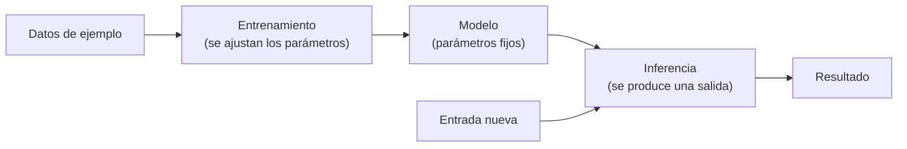

# Qué es la inteligencia artificial

> Versión en inglés: [`01-que-es-la-inteligencia-artificial.en.md`](01-que-es-la-inteligencia-artificial.en.md), traducción de esta revisión.

La empresa se dedica a las carreras. Coches propios, coches de clientes, pilotos propios y pilotos que les contratan una carrera suelta. Vaque lleva media vida en el Jarama, primero poniendo a punto coches y ahora mandando en el box: es el mecánico con el que nadie discute una puesta a punto. Va siempre con prisa, contesta corto y acierta antes de que el otro termine de explicarse.

El viernes por la tarde, en la última sesión libre, el jefe de equipo le dejó caer que había que «meter inteligencia artificial» en el taller. Que todos lo están haciendo. Vaque resopló, dijo que sí con la cabeza y siguió con lo suyo. Pero antes de cerrar el box, con las herramientas ordenadas y el café de máquina en la mano, se sentó en el banco del fondo y abrió la conversación con T1000, el asistente que usa desde hace unos meses para los informes. Le puso ese nombre el primer día, medio en broma, por una película de los noventa.

—Tú. En dos minutos. ¿Qué es la inteligencia artificial?

—En dos minutos no cabe entera, pero te doy lo importante. Cuando alguien dice «la IA», está hablando de cuatro cosas distintas y casi siempre cree que habla de una sola.

—A ver.

—**El modelo**, que es el programa que calcula. **El sistema**, que es el modelo más todo lo que lo rodea: los datos que le llegan, las herramientas que puede usar, los permisos que tiene y quién responde si algo sale mal. **El producto**, que es lo que se contrata para tener todo eso funcionando. Y **la expectativa**, que es lo que cada uno se imagina cuando oye la palabra.

—Como cuando el piloto baja del coche y dice «no va». No está diciendo si son las gomas, el motor o el reparto de pesos. Está diciendo que no va.

—Exactamente eso. Y separar las cuatro cosas sirve para lo único que importa aquí: saber cuándo no hace falta nada de esto.

—Eso me interesa. Sigue.

—Antes hay que ver qué hay dentro, porque el interior decide lo que se puede esperar.

—El otro día me dijeron que esto es como buscar en internet. Yo creo que no.

—No es buscar. Escribe lo que encaja. Y hay dos maneras de conseguir que un programa acierte, que se parecen tan poco que casi no deberían llamarse igual.

—Corta.

—Una es **escribir el conocimiento a mano**. Alguien redacta las condiciones, las consecuencias y las excepciones. Es tu tabla de pares de apriete: exacta, igual siempre, y solo cubre lo que alguien se sentó a escribir.

—Y la otra.

—**Deducirlo**. No hay reglas escritas: hay unos cuantos números que se van ajustando hasta que la respuesta se parece a la esperada.

—O sea, el oído.

—El oído. Tú escuchas un motor y sabes qué le pasa antes de levantar la tapa. Eres un perito con miles de horas. La diferencia está en que tú sabes explicar por qué, y esto no. Y en que si le cambias el contexto se equivoca con una seguridad que asusta.

—Como el que dice que un motor está bien porque en el banco dio los números.

—Justo. A la segunda manera se le llama aprendizaje automático, y cuando en este material se dice «modelo» sin más, se habla de una pieza de esa familia.

—¿Y cómo aprende?

—En dos momentos que conviene no mezclar, porque son cuentas distintas y las paga gente distinta.

T1000 le pidió que le dejara el albarán de frenos que estaba en el banco y dibujó tres cajas en el reverso.

—El **entrenamiento** es aprender. Se ven muchísimos ejemplos, se mide cuánto se aparta la respuesta de la esperada y se corrigen los números para reducir el error. Repetido miles de veces queda un ajuste que acierta en lo que ha visto y, si se ha hecho bien, en lo que no ha visto. Eso que queda es el **modelo**. No guarda los ejemplos como quien guarda fotos en un cajón; guarda el ajuste que esos ejemplos dejaron.

—¿Y lo de las vueltas?

—La **inferencia** es cada vez que le preguntas algo. Entra una pregunta, sale una respuesta, y no se aprende nada nuevo.

—Tradúcemelo.

—Aprender es montar el motor en el banco: caro, lento y una vez. Preguntar es cada vuelta que das a partir de ahí: barata de una en una, pero se paga vuelta a vuelta y así toda la temporada. Y lo que se paga no es la utilidad, es el combustible.

—¿Combustible?

—Se cobra por **tokens**, que son trozos de palabra. Pagas por lo que lees y por lo que escribes, como se paga la gasolina por litros. El mismo destino por el camino largo cuesta más que por el corto, y dando vueltas al mismo sitio se gasta igual.

—Vale. Y de esto, ¿qué me sirve a mí?

—Depende de qué parte de tu trabajo. Hay cuatro tipos de respuesta, y solo una se comprueba mal.

—Dispara.

—Puedo darte **una etiqueta**, por ejemplo qué avisos del correo son urgentes y cuáles pueden esperar al lunes. Puedo darte **un número**, por ejemplo cuántos kilómetros aguanta ese juego de gomas con ese piloto y ese circuito concreto. Puedo darte **un orden**, por ejemplo qué coche conviene atender primero cuando entran dos averías y una carrera a la vez. O puedo **redactar**: el informe que le mandas al cliente después de cada carrera, el correo al proveedor, el resumen del briefing.

—Ese informe me cuesta dos horas cada domingo.

—Las tres primeras respuestas tienen algo contra lo que medirse: se puede comprobar si la etiqueta era la correcta, si la cifra se acercó y si el orden que propuse era el útil. La cuarta, no. No existe el informe bueno de una carrera, igual que no existe la versión perfecta de un correo. Dos personas pueden escribirlo bien y ninguna ser la verdadera.

—¿Y eso cómo se arregla?

—Escribiendo antes qué cuenta como bien. Si el resultado no se comprueba solo, la pregunta «¿lo hizo bien?» solo tiene respuesta si lo decidiste de antemano. Eso lleva su tiempo y es el trabajo de verdad; de eso va la etapa de producción del material.

Vaque se levantó a comprobar una cosa del coche que estaba en el elevador. Volvió con una llave en la mano y la dejó sobre el albarán.

—¿Y cuándo te equivocas?

—De tres maneras, y las tres son previsibles. La primera: te contesto algo falso con una redacción impecable. Tiene nombre, **alucinación**, y no es una avería rara. Es lo que pasa cuando me pides que escriba lo que mejor encaja y no tengo el dato.

—El mes pasado me citaste un artículo del reglamento técnico que no existe. Lo buscamos con el comisario y no estaba.

—Ese es el caso exacto. Y no se arregla pidiéndome que no invente. Se arregla dándome el dato y comprobando lo que cuento. En tu oficio ya lo haces: la tabla de pares de apriete no se recita de memoria, se mira.

—La segunda.

—Que la misma pregunta no siempre recibe la misma respuesta. Dos veces seguidas, dos redacciones distintas, y ninguna explicación de por qué.

—Eso en mi taller es un problema. Si pregunto una cifra, quiero la cifra.

—Y ahí está el límite: para una cifra exacta no se me pregunta a mí. Si hay que sumar siete albaranes, se suman con una hoja de cálculo, no se me pide a mí que los sume.

—La tercera.

—Que no respondo de mis actos. Responde quien me pone a funcionar. Y en una ficha de coche, quien firma, responde.

—Yo firmo.

—Pues eso. Nada de lo que salga de aquí se firma sin pasar por tus manos.

Vaque se quedó callado un momento, que en él es mucho. Después hizo la pregunta que casi nadie hace.

—Entonces, ¿para qué te quiero?

—Para lo que hoy te cuesta tiempo y no es tu oficio. Encontrar el patrón en los datos de telemetría de tres temporadas, sí. Clasificar el correo de proveedores por urgencia, sí. Ordenarte los coches cuando entran cinco a la vez, sí. Redactar el informe del cliente con los datos que tú le das, sí, y tú lo corriges antes de enviarlo.

—¿Y para cuadrar los albaranes de las piezas?

—Para eso no me necesitas. Miras referencia, cantidad y precio, y si coinciden las tres cosas, está bien. Eso es una regla conocida, estable y baratísima de escribir. Si te vendo lo contrario, te estoy vendiendo un coste fijo todos los meses por algo que ya te funciona.

—Eso ya lo hago yo en cinco minutos.

—Cinco minutos y bien. Ahí no hay nada que aprender.

Vaque cogió el albarán, le dio la vuelta y escribió tres líneas con el bolígrafo que llevaba en el mono. La primera: que esto calcula, no sabe. La segunda: que el modelo, el sistema, el producto y la expectativa son cuatro cosas distintas, y que quien firma responde. La tercera: que de los cuatro tipos de respuesta, solo el de los textos no se puede comprobar solo, y que eso decide todo lo demás.

Luego pegó el papel con cinta de carrocero en el carro de herramientas, apagó la luz del box y se fue a cenar. Al día siguiente había carrera, y el coche del cliente número siete llevaba dos semanas pidiendo a gritos una puesta a punto que solo él sabía hacer. Eso no lo va a aprender ninguna máquina en mucho tiempo. Lo que cambia, y él lo sabe mejor que nadie, es que a partir de ahora parte del oficio consiste en saber qué preguntar a estos trastos y en comprobar todo lo que contestan.

> [!NOTE]
> **Lo que se llevó Vaque anotado en el albarán.** Un modelo calcula, no sabe: aprende patrones de ejemplos y devuelve lo que mejor encaja. Modelo, sistema, producto y expectativa son cuatro cosas distintas, y quien firma responde. Y de los cuatro tipos de respuesta, solo el de los textos no se comprueba solo, y eso decide cómo se evalúa todo lo demás.

## Definiciones

- **Inteligencia artificial**: familia de técnicas que hacen que un programa produzca una salida a partir de ejemplos o de reglas generales, en lugar de tener escrito el resultado de cada caso.
- **Aprendizaje automático**: rama de la inteligencia artificial en la que el comportamiento se ajusta a partir de datos, sin escribir las reglas a mano.
- **Modelo**: conjunto de parámetros ajustados durante el entrenamiento que, dada una entrada, produce una salida.
- **Entrenamiento**: proceso de ajuste de los parámetros mediante la comparación repetida entre la salida obtenida y la esperada.
- **Inferencia**: uso del modelo ya entrenado para producir una salida a partir de una entrada nueva; es el paso que se paga por consulta.
- **Parámetro**: valor interno del modelo que se modifica durante el entrenamiento y queda fijo después.
- **Token**: fragmento mínimo de texto que un modelo procesa; su número determina el coste y la latencia de una consulta.
- **Alucinación**: salida falsa con apariencia plausible, producida cuando el sistema genera lo que mejor encaja y carece del dato.
- **Generalización**: capacidad de acertar en casos no vistos durante el entrenamiento; es el objetivo del aprendizaje y su resultado nunca es perfecto.
- **Sobreajuste**: situación en la que el modelo acierta en los ejemplos de entrenamiento y falla en los nuevos.
- **Sistema**: el modelo junto con todo lo que lo rodea —datos, contexto, herramientas, permisos, registro— y la persona que responde de él.
- **Datos de entrenamiento**: conjunto de ejemplos con el que se ajustan los parámetros de un modelo; determina qué sabe hacer y qué no.

## Referencias

- *Computing Machinery and Intelligence* — A. M. Turing, *Mind*, vol. LIX, nº 236, 1950 — copia accesible en <https://www.csee.umbc.edu/courses/471/papers/turing.pdf> (original tras muro de pago en <https://academic.oup.com/mind/article/LIX/236/433/986238>) (consultado 2026-10-10)
- *A Proposal for the Dartmouth Summer Research Project on Artificial Intelligence* — J. McCarthy, M. Minsky, N. Rochester y C. Shannon, 1955 — <http://jmc.stanford.edu/articles/dartmouth/dartmouth.pdf> (consultado 2026-10-10)
- *Artificial Intelligence Risk Management Framework (AI RMF 1.0)* — NIST, 2023 — <https://doi.org/10.6028/NIST.AI.100-1> (consultado 2026-10-10)
- *Reglamento (UE) 2024/1689* por el que se establecen normas armonizadas en materia de inteligencia artificial — Diario Oficial de la Unión Europea — <https://eur-lex.europa.eu/eli/reg/2024/1689/oj> (consultado 2026-10-10)
- *Language Models are Few-Shot Learners* — T. Brown y otros, 2020 — <https://arxiv.org/abs/2005.14165> (consultado 2026-10-10)
- Comprobación propia — las cinco direcciones anteriores devolvieron código 200 en una petición HTTP el 2026-10-10, salvo la canónica de *Mind*, que respondió 403 y se acompaña de copia abierta

## Continuar

- Anterior: [Punto de partida](../00-punto-de-partida.md)
- Siguiente: [De Turing a AlexNet: la historia hasta 2012](02-historia-hasta-2012.md)
- Para decidir cuándo un problema no necesita nada de esto: [Dónde no hace falta inteligencia artificial](05-donde-no-hace-falta-ia.md)
- Para lo que viene después —elegir modelo, diseñar flujos con estado, operar en producción—: etapas 1 a 4 del camino, en preparación
- Índice de la etapa: [Etapa 0 — Fundamentos](README.md)
- Índice temático: [`../../INDEX.md`](../../INDEX.md)

---

*Pepe, asistido por IA. Última revisión: 2026-10-10.*
