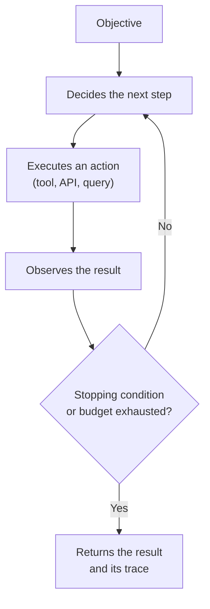

# What an agent is and what it is not

> English translation of the Spanish original: [04-que-es-y-que-no-es-un-agente.md](04-que-es-y-que-no-es-un-agente.md). Spanish is the canonical text; this version follows the revision of 10 October 2026.

In the pit box at Jarama this is talked about every week, even though nobody uses these words. A salesperson sells «agents» that do everything, a software vendor promises that its tool «acts on its own» and in the workshop people ask, rightly, whether that means something is going to touch the car without anybody watching. The word has become so elastic that it no longer distinguishes anything.

And yet the distinction is simple, and it is the one that decides who answers for what happens. It has nothing to do with how clever the system is, but with **who decides the next step and who executes it**.

## Three situations that get confused every day

**Automation.** The procedure is written down: what to do in each situation, in what order and under what conditions. The system executes and decides nothing that was not foreseen. It is deterministic, it can be tested without examples and its failure reproduces on the first try. All the software that has always existed lives here: business rules, scheduled tasks, integration flows.

**Assistant.** A model generates a proposal —a text, a plan, a piece of code, a query— and **a person decides** whether to use it. The system touches nothing that matters: the only one who executes is the human. What defines the boundary is not the quality of the answer, but who presses the button.

**Agent.** The system decides the next step and **executes it** on external tools, in a loop, until it meets a stopping condition or exhausts a budget. Compared with the assistant there are three new things: the choice of the step, the execution of the action and the duration of the execution with nobody in front of it.

Put in a table, the differences that matter are these:

| Criterion | Automation | Assistant | Agent |
|:--|:--|:--|:--|
| Who decides the next step | The code, always the same | The person | The model |
| Who executes the action | The code | The person | The system |
| How long it runs without a human | Indefinite, but bounded by design | One interaction | A variable number of steps |
| What has to be written beforehand | The procedure | The review criterion | The stopping condition, the budget and the permissions |
| How it is checked | Deterministic tests | Sampling and review | Case-based evaluation, trace and audit of what was executed |

> [!NOTE]
> It is worth looking at the last row, because it is the one that gets forgotten. A system that acts on its own and keeps no trace of what it did cannot be reviewed, and what cannot be reviewed sooner or later breaks and nobody knows why.

## The loop, from the inside

The minimal pattern combines reasoning and action: the model proposes a step, the system executes it against a tool, the result goes back to the model and the cycle repeats.

Four pieces hold up that loop, and all four are design decisions, not implementation details:

**Tools** are what the system can do: query the warehouse, read a car's record, write to the ordering system, notify the supplier. A well-defined tool narrows the space of actions. A generic tool —«run code»— opens it up entirely, with all that this means.

**State** is what is kept between steps: what has been tried, what has failed, what has been found out. Without state, the loop repeats the same mistakes. With too much state, each step costs more than the previous one.

**The stopping condition** is when it counts as finished. Without it the system does not stop: it spends. It can be a met objective, a maximum number of steps, a time or an amount.

**Permissions and oversight** are what it can change on its own and what needs confirmation. This is the section that separates a demonstration from a system in production.

From this comes the idea that is hardest to accept: **autonomy is not a level, it is a trade-off**. There is no scale of «cleverer» that runs from automation to agent. What changes as you move to the right is how many decisions are delegated and how long it takes a person to be able to correct a mistake. A system with a lot of autonomy and little evaluation is not an advanced system: it is an expensive way of producing failures quickly.

## The usual stumbles

- **Calling an assistant with a good system message an agent.** If the human is still executing, there is no agent. It is not a difference of degree, it is a difference of who acts.
- **Calling automation intelligence.** A flow that applies rules does not become an agent because one of its branches queries a model. If the distribution of decisions does not change, the category does not change.
- **Not writing the stopping condition.** It is the most expensive and the most frequent mistake: loops that do not end, spend that grows without control and the same action repeated on the same record.
- **Confusing using tools with being autonomous.** An API can be queried in a completely deterministic way, with no decision delegated.
- **Granting write permissions before having evaluation.** The temptation is obvious, because writing is what makes the system useful. The correct order is the opposite: first observation and logging, then case-based evaluation and only then writing, with limits.
- **Multiplying agents before it is needed.** Each additional agent adds coordination, shared state and new ways of failing. Stage 3 of the path deals with these patterns and, in each one, the failure it prevents: if there is no identified failure that justifies the architecture, the architecture is superfluous.

## When it does not apply

There are two cases in which the category «agent» does not fit and forcing it makes the system more expensive.

The first: **the procedure is fixed**. If the steps are known and do not change with the input, automation is cheaper, faster and easier to audit. Putting a model there is adding variability in exchange for nothing.

The second: **there is no written success criterion**. An agent pursues an objective; if that objective cannot be stated in a checkable way, it cannot be evaluated, and without evaluation there is no way of knowing whether the system is getting better or worse. When that happens, the pending work is not architecture, it is definition.

This page describes the conceptual boundary, not a catalogue of patterns. The concrete architectures —tool use, reflection, planning, collaboration between agents, human oversight and self-repair— are studied in Stage 3 (Agentic patterns, in preparation), and their operation, in Stage 4 (Production, in preparation).

## Definitions

- **Automation**: a system that executes a written procedure, deciding nothing that was not foreseen.
- **Assistant**: a system that proposes an output and leaves the decision and the execution in the hands of a person.
- **Agent**: a system that decides the next step and executes it on external tools, in a loop, until a stopping condition.
- **Tool**: a concrete action that a system can execute on the outside world, with a defined interface and associated permissions.
- **Agent loop**: the cycle of deciding, executing and observing that repeats until the stopping condition.
- **Stopping condition**: an explicit criterion that ends the execution: objective met, number of steps, time or spend.
- **Execution budget**: the limit of compute, time or money assigned to an execution before it stops by itself.
- **Human oversight**: intervention foreseen in the design by which a person approves or rejects an action before or after it happens.
- **Autonomy**: a measure of how many decisions are delegated to the system and how long it takes a person to be able to correct a mistake, not of the model's capability.
- **Multi-agent system**: a set of agents that collaborate on a task, with coordination and shared state between them.
- **Trace**: an ordered record of the steps, the actions and the observations of an execution, needed in order to be able to audit it.

## References

- *ReAct: Synergizing Reasoning and Acting in Language Models* — S. Yao and others, 2022 — <https://arxiv.org/abs/2210.03629> (accessed 2026-10-10)
- *Building effective agents* — Anthropic, 2024 (the manufacturer's engineering guide; it distinguishes workflows from agents) — <https://www.anthropic.com/engineering/building-effective-agents> (accessed 2026-10-10)
- *AI Agents vs. Agentic AI: A Conceptual Taxonomy, Applications and Challenges* — R. Sapkota, K. I. Roumeliotis and M. Karkee, 2025 (conceptual review of the terminology) — <https://arxiv.org/abs/2505.10468> (accessed 2026-10-10)
- *Introducing the Model Context Protocol* and specification — Anthropic / Model Context Protocol, 2024 — <https://www.anthropic.com/news/model-context-protocol> and <https://modelcontextprotocol.io/introduction> (accessed 2026-10-10)
- *Artificial Intelligence Risk Management Framework (AI RMF 1.0)* — NIST, 2023 (it treats human oversight as a risk management requirement) — <https://doi.org/10.6028/NIST.AI.100-1> (accessed 2026-10-10)
- Own check — the above addresses returned code 200 in an HTTP request on 2026-10-10

## Continue

- Previous: [From AlexNet to agents: the history since 2012](03-historia-desde-2012.en.md)
- Next: [Where artificial intelligence is not needed](05-donde-no-hace-falta-ia.en.md)
- Stage index: [Stage 0 — Foundations](README.md)
- Subject index: [`../../INDEX.md`](../../INDEX.md)

---

*Pepe, assisted by AI. Last reviewed: 2026-10-10.*