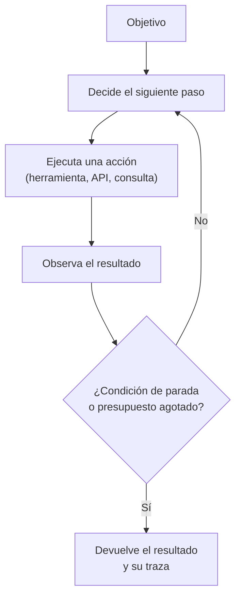

# Qué es y qué no es un agente

> **Pregunta que resuelve:** ¿dónde está la frontera entre una automatización, un asistente y un sistema agéntico?

## Para qué sirve

«Agente» se ha convertido en la palabra más elástica del sector: designa a la vez un asistente conversacional, un programa que rellena formularios y un sistema que modifica código en producción. La palabra no describe un nivel de inteligencia, sino un **reparto de decisiones**. Definir ese reparto con precisión es lo que permite saber a qué se está comprometiendo quien pone un sistema de estos en marcha.

La página fija tres categorías —automatización, asistente y agente— y un criterio operativo para decidir en cuál está un caso concreto.

## Las tres categorías

**Automatización.** El procedimiento está escrito: qué hacer en cada situación, en qué orden y con qué condiciones. El sistema ejecuta y no decide nada que no estuviera previsto. Es determinista, se puede probar sin datos de ejemplo y su fallo es reproducible. Aquí entran los programas de siempre, las reglas de negocio, las tareas programadas y los flujos de integración.

**Asistente.** Un modelo genera una propuesta —un texto, un plan, un fragmento de código, una consulta— y **una persona decide** si se usa. El sistema no actúa sobre nada que importe: el único que ejecuta es el humano. La frontera no está en la calidad de la respuesta, sino en quién aprieta el botón.

**Agente.** El sistema decide el siguiente paso y **lo ejecuta** sobre herramientas externas, en un bucle, hasta cumplir una condición de parada o agotar un presupuesto. Aquí hay tres cosas nuevas respecto al asistente: la elección del paso, la ejecución de la acción y la duración de la ejecución sin intervención humana.

| Criterio | Automatización | Asistente | Agente |
|:--|:--|:--|:--|
| Quién decide el siguiente paso | El código, siempre igual | La persona | El modelo |
| Quién ejecuta la acción | El código | La persona | El sistema |
| Cuánto dura sin humano | Indefinido, pero acotado por diseño | Una interacción | Un número variable de pasos |
| Qué necesita escrito antes | El procedimiento | El criterio de revisión | La condición de parada, el presupuesto y los permisos |
| Cómo se comprueba | Pruebas deterministas | Muestreo y revisión | Evaluación por casos, traza y auditoría de lo ejecutado |

## Cómo funciona un agente

El patrón mínimo combina razonamiento y acción: el modelo propone un paso, el sistema lo ejecuta contra una herramienta, el resultado vuelve al modelo y el ciclo se repite.

Cuatro piezas sostienen ese bucle, y las cuatro son decisiones de diseño, no detalles de implementación:

1. **Herramientas.** Lo que el sistema puede hacer: consultar una base de datos, leer un archivo, llamar a un servicio, modificar un registro. Una herramienta bien definida acota el espacio de acciones; una herramienta genérica —«ejecutar código»— lo abre entero.
2. **Estado.** Lo que el sistema conserva entre pasos: qué ha intentado, qué ha fallado, qué ha averiguado. Sin estado, el bucle repite errores; con demasiado estado, el coste crece en cada paso.
3. **Condición de parada.** Cuándo se considera terminado. Sin ella, el sistema no termina: gasta. La condición puede ser un objetivo cumplido, un número máximo de pasos, un tiempo o un gasto máximo.
4. **Permisos y supervisión.** Qué puede modificar el sistema por su cuenta y qué necesita confirmación. Es el apartado que separa una demostración de un sistema en explotación, y el que se decide en la Etapa 4.

**La autonomía no es un nivel, es un compromiso.** No hay una escala de «más inteligente» que vaya de la automatización al agente. Lo que cambia al moverse hacia la derecha en esa escala es cuántas decisiones se delegan y cuánto tarda una persona en poder corregir un error. Un sistema con una autonomía amplia y una evaluación pobre es una forma cara de producir fallos rápidos.

## Errores frecuentes

- **Llamar agente a un asistente con un buen mensaje de sistema.** Si el humano sigue ejecutando, no hay agente. La distinción no es de grado: es de quién actúa.
- **Llamar inteligencia a la automatización.** Un flujo que aplica reglas claras no se vuelve agente porque una de sus ramas consulte a un modelo. Si el reparto de decisiones no cambia, la categoría no cambia.
- **No escribir la condición de parada.** Es el error más caro y el más común: bucles que no terminan, gasto que crece sin control y acciones repetidas sobre el mismo registro.
- **Confundir usar herramientas con ser autónomo.** Se puede consultar una API de forma completamente determinista, sin ninguna decisión delegada.
- **Conceder permisos de escritura antes de tener evaluación.** La tentación es evidente: es lo que hace útil al sistema. El orden correcto es al contrario: primero observación y registro, después evaluación por casos, y solo entonces escritura con límites.
- **Multiplicar agentes antes de necesitarlo.** Cada agente adicional añade coordinación, estado compartido y nuevas formas de fallar. La Etapa 3 (Patrones agénticos, en preparación) trata estos patrones y, en cada uno, el fallo que previene: si no hay un fallo identificado que justifique la arquitectura, la arquitectura sobra.

## Cuándo no aplica

Dos casos claros en los que la categoría «agente» no corresponde y forzarla encarece el sistema:

1. **El procedimiento es fijo.** Si los pasos se conocen y no cambian con la entrada, la automatización es más barata, más rápida y más fácil de auditar. Un modelo añade variabilidad a cambio de nada.
2. **No existe un criterio de éxito escrito.** Un agente persigue un objetivo; si ese objetivo no se puede enunciar de forma comprobable, el sistema no se puede evaluar, y sin evaluación no hay forma de saber si mejora o empeora. En ese caso el trabajo pendiente no es de arquitectura, es de definición.

Tampoco es esta página un catálogo de patrones: describe la frontera conceptual. Las arquitecturas concretas —uso de herramientas, reflexión, planificación, colaboración entre agentes, supervisión humana y autorreparación— se estudian en la Etapa 3 (Patrones agénticos, en preparación), y su operación en producción, en la Etapa 4 (Producción, en preparación).

## Definiciones

- **Automatización**: sistema que ejecuta un procedimiento escrito, sin decidir nada que no estuviera previsto.
- **Asistente**: sistema que propone una salida y deja la decisión y la ejecución en manos de una persona.
- **Agente**: sistema que decide el siguiente paso y lo ejecuta sobre herramientas externas, en un bucle, hasta una condición de parada.
- **Herramienta**: acción concreta que un sistema puede ejecutar sobre el exterior, con una interfaz definida y unos permisos asociados.
- **Bucle de agente**: ciclo de decidir, ejecutar y observar que se repite hasta la condición de parada.
- **Condición de parada**: criterio explícito que termina la ejecución: objetivo cumplido, número de pasos, tiempo o gasto.
- **Presupuesto de ejecución**: límite de cómputo, tiempo o dinero asignado a una ejecución antes de que se detenga por sí sola.
- **Supervisión humana**: intervención prevista en el diseño por la que una persona aprueba o rechaza una acción antes o después de que ocurra.
- **Autonomía**: medida de cuántas decisiones se delegan en el sistema y de cuánto tarda una persona en poder corregir un error, no de la capacidad del modelo.
- **Sistema multiagente**: conjunto de agentes que colaboran en una tarea, con coordinación y estado compartido entre ellos.
- **Traza**: registro ordenado de los pasos, las acciones y las observaciones de una ejecución, necesario para poder auditarla.

## Referencias

- *ReAct: Synergizing Reasoning and Acting in Language Models* — S. Yao y otros, 2022 — <https://arxiv.org/abs/2210.03629> (consultado 2026-10-10)
- *Building effective agents* — Anthropic, 2024 (guía de ingeniería del fabricante; distingue flujos de trabajo de agentes) — <https://www.anthropic.com/engineering/building-effective-agents> (consultado 2026-10-10)
- *AI Agents vs. Agentic AI: A Conceptual Taxonomy, Applications and Challenges* — R. Sapkota y otros, 2025 (revisión conceptual de la terminología) — <https://arxiv.org/abs/2505.10468> (consultado 2026-10-10)
- *Introducing the Model Context Protocol* y especificación — Anthropic / Model Context Protocol, 2024 — <https://www.anthropic.com/news/model-context-protocol> y <https://modelcontextprotocol.io/introduction> (consultado 2026-10-10)
- *Artificial Intelligence Risk Management Framework (AI RMF 1.0)* — NIST, 2023 (trata la supervisión humana como requisito de gestión del riesgo) — <https://doi.org/10.6028/NIST.AI.100-1> (consultado 2026-10-10)
- Comprobación propia — las direcciones anteriores devolvieron código 200 en una petición HTTP el 2026-10-10

## Continuar

- Anterior: [De AlexNet a los agentes: la historia desde 2012](03-historia-desde-2012.md)
- Siguiente: [Dónde no hace falta inteligencia artificial](05-donde-no-hace-falta-ia.md)
- Índice de la etapa: [Etapa 0 — Fundamentos](README.md)
- Índice temático: [`../../INDEX.md`](../../INDEX.md)