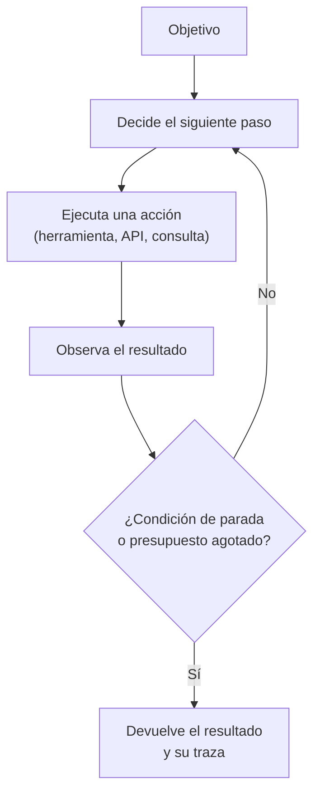

# Qué es y qué no es un agente

> Versión en inglés: [`04-que-es-y-que-no-es-un-agente.en.md`](04-que-es-y-que-no-es-un-agente.en.md), traducción de esta revisión.

En el box del Jarama se habla de esto cada semana, aunque nadie use estas palabras. Un comercial vende «agentes» que hacen de todo, un proveedor de software promete que su herramienta «actúa sola» y en el taller se pregunta, con razón, si eso significa que algo va a tocar el coche sin que nadie lo mire. La palabra se ha vuelto tan elástica que ya no distingue nada.

Y sin embargo la distinción es sencilla, y es la que decide quién responde de lo que pasa. No tiene que ver con lo listo que sea el sistema, sino con **quién decide el siguiente paso y quién lo ejecuta**.

## Tres situaciones que se confunden a diario

**Automatización.** El procedimiento está escrito: qué hacer en cada situación, en qué orden y con qué condiciones. El sistema ejecuta y no decide nada que no estuviera previsto. Es determinista, se puede probar sin ejemplos y su fallo se reproduce a la primera. Aquí está todo el software de siempre: las reglas de negocio, las tareas programadas, los flujos de integración.

**Asistente.** Un modelo genera una propuesta —un texto, un plan, un fragmento de código, una consulta— y **una persona decide** si se usa. El sistema no toca nada que importe: el único que ejecuta es el humano. Lo que define la frontera no es la calidad de la respuesta, sino quién aprieta el botón.

**Agente.** El sistema decide el siguiente paso y **lo ejecuta** sobre herramientas externas, en un bucle, hasta cumplir una condición de parada o agotar un presupuesto. Respecto al asistente hay tres cosas nuevas: la elección del paso, la ejecución de la acción y la duración de la ejecución sin nadie delante.

Puestos en una tabla, las diferencias que importan son estas:

| Criterio | Automatización | Asistente | Agente |
|:--|:--|:--|:--|
| Quién decide el siguiente paso | El código, siempre igual | La persona | El modelo |
| Quién ejecuta la acción | El código | La persona | El sistema |
| Cuánto dura sin humano | Indefinido, pero acotado por diseño | Una interacción | Un número variable de pasos |
| Qué hay que escribir antes | El procedimiento | El criterio de revisión | La condición de parada, el presupuesto y los permisos |
| Cómo se comprueba | Pruebas deterministas | Muestreo y revisión | Evaluación por casos, traza y auditoría de lo ejecutado |

> [!NOTE]
> Conviene fijarse en la última fila, porque es la que se olvida. Un sistema que actúa solo y no guarda rastro de lo que hizo no se puede revisar, y lo que no se puede revisar tarde o temprano se cae y nadie sabe por qué.

## El bucle, por dentro

El patrón mínimo combina razonamiento y acción: el modelo propone un paso, el sistema lo ejecuta contra una herramienta, el resultado vuelve al modelo y el ciclo se repite.

Cuatro piezas sostienen ese bucle, y las cuatro son decisiones de diseño, no detalles de implementación:

**Las herramientas** son lo que el sistema puede hacer: consultar el almacén, leer una ficha de coche, escribir en el sistema de pedidos, avisar al proveedor. Una herramienta bien definida acota el espacio de acciones. Una herramienta genérica —«ejecutar código»— lo abre entero, con todo lo que eso significa.

**El estado** es lo que se conserva entre pasos: qué se ha intentado, qué ha fallado, qué se ha averiguado. Sin estado, el bucle repite los mismos errores. Con demasiado estado, cada paso cuesta más que el anterior.

**La condición de parada** es cuándo se considera terminado. Sin ella el sistema no termina: gasta. Puede ser un objetivo cumplido, un número máximo de pasos, un tiempo o un importe.

**Los permisos y la supervisión** son qué puede modificar por su cuenta y qué necesita confirmación. Es el apartado que separa una demostración de un sistema en explotación.

De ahí sale la idea que más cuesta aceptar: **la autonomía no es un nivel, es un compromiso**. No hay una escala de «más listo» que vaya de la automatización al agente. Lo que cambia al moverse hacia la derecha es cuántas decisiones se delegan y cuánto tarda una persona en poder corregir un error. Un sistema con mucha autonomía y poca evaluación no es un sistema avanzado: es una forma cara de producir fallos deprisa.

## Los tropiezos de siempre

- **Llamar agente a un asistente con un buen mensaje de sistema.** Si el humano sigue ejecutando, no hay agente. No es una diferencia de grado, es una diferencia de quién actúa.
- **Llamar inteligencia a la automatización.** Un flujo que aplica reglas no se vuelve agente porque una de sus ramas consulte a un modelo. Si el reparto de decisiones no cambia, la categoría no cambia.
- **No escribir la condición de parada.** Es el error más caro y el más frecuente: bucles que no acaban, gasto que crece sin control y la misma acción repetida sobre el mismo registro.
- **Confundir usar herramientas con ser autónomo.** Se puede consultar una API de forma completamente determinista, sin ninguna decisión delegada.
- **Dar permisos de escritura antes de tener evaluación.** La tentación es evidente, porque escribir es lo que hace útil al sistema. El orden correcto es el contrario: primero observación y registro, después evaluación por casos y solo entonces escritura, con límites.
- **Multiplicar agentes antes de necesitarlo.** Cada agente adicional añade coordinación, estado compartido y nuevas formas de fallar. La etapa 3 del camino trata estos patrones y, en cada uno, el fallo que previene: si no hay un fallo identificado que justifique la arquitectura, la arquitectura sobra.

## Cuándo no aplica

Hay dos casos en los que la categoría «agente» no corresponde y forzarla encarece el sistema.

El primero: **el procedimiento es fijo**. Si los pasos se conocen y no cambian con la entrada, la automatización es más barata, más rápida y más fácil de auditar. Meter un modelo ahí es añadir variabilidad a cambio de nada.

El segundo: **no existe un criterio de éxito escrito**. Un agente persigue un objetivo; si ese objetivo no se puede enunciar de forma comprobable, no se puede evaluar, y sin evaluación no hay manera de saber si el sistema mejora o empeora. Cuando pasa eso, el trabajo pendiente no es de arquitectura, es de definición.

Esta página describe la frontera conceptual, no un catálogo de patrones. Las arquitecturas concretas —uso de herramientas, reflexión, planificación, colaboración entre agentes, supervisión humana y autorreparación— se estudian en la Etapa 3 (Patrones agénticos, en preparación), y su operación, en la Etapa 4 (Producción, en preparación).

## Definiciones

- **Automatización**: sistema que ejecuta un procedimiento escrito, sin decidir nada que no estuviera previsto.
- **Asistente**: sistema que propone una salida y deja la decisión y la ejecución en manos de una persona.
- **Agente**: sistema que decide el siguiente paso y lo ejecuta sobre herramientas externas, en un bucle, hasta una condición de parada.
- **Herramienta**: acción concreta que un sistema puede ejecutar sobre el exterior, con una interfaz definida y unos permisos asociados.
- **Bucle de agente**: ciclo de decidir, ejecutar y observar que se repite hasta la condición de parada.
- **Condición de parada**: criterio explícito que termina la ejecución: objetivo cumplido, número de pasos, tiempo o gasto.
- **Presupuesto de ejecución**: límite de cómputo, tiempo o dinero asignado a una ejecución antes de que se detenga por sí sola.
- **Supervisión humana**: intervención prevista en el diseño por la que una persona aprueba o rechaza una acción antes o después de que ocurra.
- **Autonomía**: medida de cuántas decisiones se delegan en el sistema y de cuánto tarda una persona en poder corregir un error, no de la capacidad del modelo.
- **Sistema multiagente**: conjunto de agentes que colaboran en una tarea, con coordinación y estado compartido entre ellos.
- **Traza**: registro ordenado de los pasos, las acciones y las observaciones de una ejecución, necesario para poder auditarla.

## Referencias

- *ReAct: Synergizing Reasoning and Acting in Language Models* — S. Yao y otros, 2022 — <https://arxiv.org/abs/2210.03629> (consultado 2026-10-10)
- *Building effective agents* — Anthropic, 2024 (guía de ingeniería del fabricante; distingue flujos de trabajo de agentes) — <https://www.anthropic.com/engineering/building-effective-agents> (consultado 2026-10-10)
- *AI Agents vs. Agentic AI: A Conceptual Taxonomy, Applications and Challenges* — R. Sapkota, K. I. Roumeliotis y M. Karkee, 2025 (revisión conceptual de la terminología) — <https://arxiv.org/abs/2505.10468> (consultado 2026-10-10)
- *Introducing the Model Context Protocol* y especificación — Anthropic / Model Context Protocol, 2024 — <https://www.anthropic.com/news/model-context-protocol> y <https://modelcontextprotocol.io/introduction> (consultado 2026-10-10)
- *Artificial Intelligence Risk Management Framework (AI RMF 1.0)* — NIST, 2023 (trata la supervisión humana como requisito de gestión del riesgo) — <https://doi.org/10.6028/NIST.AI.100-1> (consultado 2026-10-10)
- Comprobación propia — las direcciones anteriores devolvieron código 200 en una petición HTTP el 2026-10-10

## Continuar

- Anterior: [De AlexNet a los agentes: la historia desde 2012](03-historia-desde-2012.md)
- Siguiente: [Dónde no hace falta inteligencia artificial](05-donde-no-hace-falta-ia.md)
- Índice de la etapa: [Etapa 0 — Fundamentos](README.md)
- Índice temático: [`../../INDEX.md`](../../INDEX.md)

---

*Pepe. Última revisión: 2026-10-10.*
