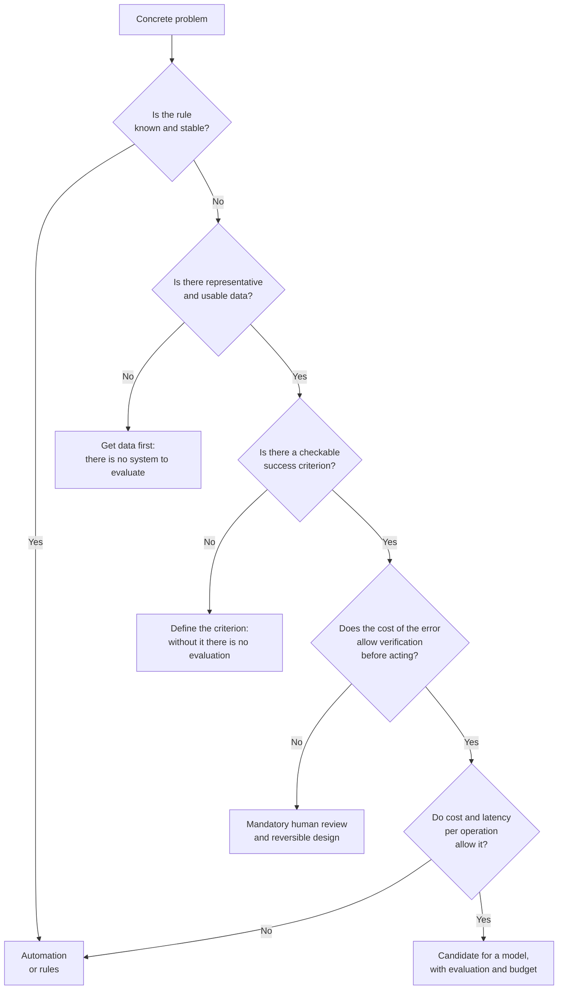

# Where artificial intelligence is not needed

> English translation of the Spanish original: [05-donde-no-hace-falta-ia.md](05-donde-no-hace-falta-ia.md). Spanish is the canonical text; this version follows the revision of 10 October 2026.

This is the most profitable page of the stage, and it goes against almost everything that is read on the subject. Choosing a model well saves time; ruling out a system that was not needed saves a cost every month, a new failure surface and a periodic discussion about why the result changes.

Think of the racing workshop. Every season somebody proposes three things «with artificial intelligence»: reconciling the delivery notes for the parts, deciding how many sets of tyres to load on the truck and writing the report that is sent to the client after each race. The three sound the same and the three are completely different cases. One is solved with a query, the second probably does call for a model and the third is an assistant with human review. Putting the same system in all three is what this material calls **forced agentification**: putting a model in front of a procedure that already worked. It happens in two ways: through commercial pressure —something with artificial intelligence has to be offered— and through technical convenience, because building an agent is more entertaining than reading a procedure and automating it.

## Eight conditions that rule out a model

Each of these conditions, on its own, is enough not to use a generative model as the main piece. They are written as things that can be checked, not as opinions.

1. **The rule is known and stable.** If the procedure can be written as conditions, and those conditions rarely change, automation is faster, cheaper and auditable. Reconciling a delivery note belongs to this group: reference, quantity and price.
2. **Determinism is required.** Invoicing, payroll, calculating deadlines, numbering documents. The same input has to produce exactly the same output, and a model does not guarantee that.
3. **Numerical accuracy is required.** Arithmetic, accounting, aggregations, looking up a specific value. A language model produces plausible text; for counting there is a calculator, a spreadsheet or a query.
4. **The cost of the error is high and it cannot be verified before acting.** A payment, a diagnosis, a deletion, a change in production. That requires human oversight and a way back, not a more capable model.
5. **The volume does not make up for what it costs to build and maintain it.** Below a few hundred cases a month with variable judgment, a trained person is usually cheaper: the system has to be built, evaluated, maintained and every use paid for.
6. **There is no data, or it cannot be used.** Without representative examples there is no possible evaluation, and without evaluation nobody can say whether the system works. Add to this the legal or contractual restriction on the data that would leave towards an external provider.
7. **The problem is not the model, but the data, the integration or the process.** If the spare part is in two systems that do not talk to each other, or if nobody knows today who decides what, no model fixes that. It is the most expensive diagnosis of all: a system is built around a process that was not defined.
8. **Latency or cost per operation do not allow it.** Strict real time, millions of operations a day or a cost below a cent: a model per operation rarely fits.

## What is used instead

| If what rules is… | The reasonable alternative is… |
|:--|:--|
| A known and stable rule | Business rules, validations, a written flow or a function |
| Determinism and traceability | Deterministic code with logging of decisions; review by exception |
| Numerical accuracy | A spreadsheet, a database query or a calculation service |
| Retrieving a specific piece of data | A search index, a regular expression or a direct query |
| Choosing between options with constraints | Classical optimisation or a solver, not a generative model |
| Predicting a number from historical data | Classical statistics or a small, measured model; often enough |
| Classifying with known labels | A trained classifier, evaluated with false positives and negatives separately |
| Mechanical tasks on screens | Process automation, with its documented limits |
| Variable judgment and low volume | A person with a checklist |
| All of the above with text around it | A model as support, with human review and verifiable output |

## How it is decided

The following sequence is not meant to be exhaustive; it is designed to rule things out quickly, which is what is needed most of the time.

> [!NOTE]
> It is worth accompanying the route with an elementary calculation, made with one's own numbers and not estimated: how much it costs to build it, how much to evaluate it, how much each use, how much to review the errors it makes and how much the process costs today as it stands. That calculation is developed in Stage 1 (Professional use, in preparation). Here a rule is enough: a figure without an origin is no use for deciding.

## What forced agentification costs

Putting a model where there was a procedure that worked has concrete consequences, all foreseeable:

- **Variable cost that is hard to budget.** You pay per use, and the use depends on what is written. A cost that grows with the conversation does not look like an infrastructure cost.
- **Latency.** Each operation goes from taking milliseconds to taking seconds.
- **Non-determinism.** Two identical executions can differ, and with them the ability to reproduce an incident is lost.
- **New failure surface.** Plausible errors appear: malformed outputs, repeated actions, loops. They are harder to detect than an exception.
- **Vendor dependence.** The behaviour depends on a third-party service, on its version and on its terms.
- **Evaluation pending forever.** Without a written success criterion, nobody will be able to claim that the change improved anything.
- **Loss of understanding of the process.** When the procedure lives inside a prompt, the team can no longer explain why the system did what it did.

The engineering literature is explicit on the two points that are most ignored: that a machine learning system is a small part of a larger system, and that debt accumulates above all around the model, not inside it.

## The usual stumbles

- **Starting with the technology.** The useful order is the opposite: first the process, then the success criterion and only then the technique.
- **Confusing a demonstration with an evaluation.** A demonstration chooses the cases; an evaluation chooses them before knowing what will happen with them.
- **Justifying the decision with the existence of a tool.** That a product exists that does it does not mean it is the shortest or the cheapest path.
- **Replacing a system that works.** If the current process delivers and its cost is known, the burden of proof lies with whoever proposes changing it.
- **Reading this page backwards.** This page is not saying «do not use artificial intelligence»: it is saying that you have to be able to justify why it is used, with the cost and the expected failure written down.

## When it does not apply

The previous conditions serve to rule out, not to forbid. There are combinations that work well and are frequent: a model that proposes and a rule that validates; a classifier that filters and a person who decides; a model that writes from data obtained by query. The mixture is chosen just like the rest: by the failure each piece prevents.

Nor does this page serve as a sales argument either for or against. A decision like this is supported by the numbers of the concrete case —volume, cost, cost of the error—, and those cannot be borrowed from a generic page. The [practice of the stage](practica.en.md) consists precisely in doing that exercise on three processes of one's own.

## Definitions

- **Forced agentification**: the use of a system with a model where a written procedure was enough, without justification of cost or of expected failure.
- **Disqualifying condition**: a checkable condition that, if met, excludes the use of a model as the main piece.
- **Cost per operation**: the total cost of resolving a case, including the expense of reviewing and correcting the system's errors.
- **Reversibility**: the property of an action that can be undone without consequences; it conditions whether an autonomous system can execute it.
- **Hybrid system**: a combination of rules, models and human review, each piece with a declared function and a declared limit.
- **Technical debt in machine learning systems**: the cost accumulated in what surrounds the model —data, configuration, integration, evaluation— more than in the model itself.

## References

- *Rules of Machine Learning: Best Practices for ML Engineering* — M. Zinkevich, Google — <https://developers.google.com/machine-learning/guides/rules-of-ml> (accessed 2026-10-10)
- *Hidden Technical Debt in Machine Learning Systems* — D. Sculley and others, NIPS 2015 — <https://papers.nips.cc/paper_files/paper/2015/hash/86df7dcfd896fcaf2674f757a2463eba-Abstract.html> (accessed 2026-10-10)
- *Artificial Intelligence Risk Management Framework (AI RMF 1.0)* — NIST, 2023 — <https://doi.org/10.6028/NIST.AI.100-1> (accessed 2026-10-10)
- *Building effective agents* — Anthropic, 2024 (it insists on starting with the simplest solution and adding complexity only when it is justified) — <https://www.anthropic.com/engineering/building-effective-agents> (accessed 2026-10-10)
- Own check — the above addresses returned code 200 in an HTTP request on 2026-10-10

## Continue

- Previous: [What an agent is and what it is not](04-que-es-y-que-no-es-un-agente.en.md)
- Next: [The trade in 2026](06-el-oficio-en-2026.en.md)
- Practice of the stage: [Analysis of three processes of one's own](practica.en.md)
- Stage index: [Stage 0 — Foundations](README.md)
- Subject index: [`../../INDEX.md`](../../INDEX.md)

---

*Pepe, assisted by AI. Last reviewed: 2026-10-10.*