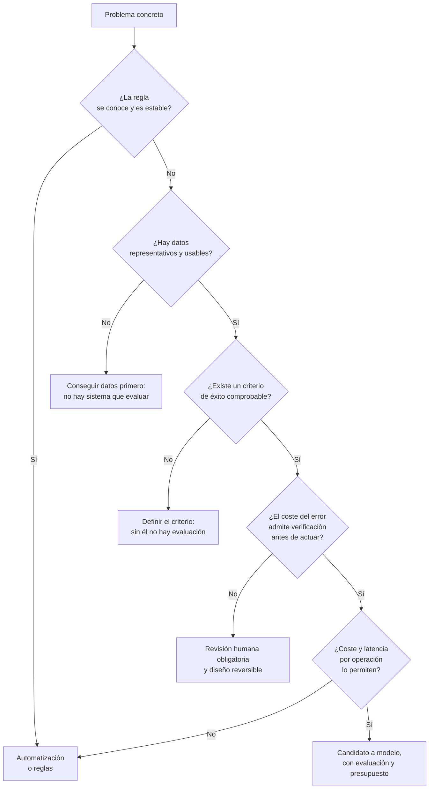

# Dónde no hace falta inteligencia artificial

> **Pregunta que resuelve:** ¿cuándo un problema no se resuelve con inteligencia artificial y qué se usa en su lugar?

## Para qué sirve

Es la página más rentable de la etapa. Elegir bien un modelo ahorra tiempo; descartar un sistema que no hacía falta ahorra un presupuesto recurrente, una superficie de fallo nueva y una discusión mensual sobre por qué el resultado cambia.

El error que previene tiene nombre propio en este material: la **agentificación forzada**, poner un modelo delante de un procedimiento que ya funcionaba. Ocurre por dos caminos: por presión comercial —hay que ofrecer algo con inteligencia artificial— y por comodidad técnica, porque es más entretenido montar un agente que leer un procedimiento y automatizarlo.

## Criterios de descarte

Cada uno de estos criterios, por sí solo, basta para no usar un modelo generativo como pieza principal. Se enuncian como condiciones comprobables, no como opiniones.

1. **La regla se conoce y es estable.** Si el procedimiento se puede escribir en condiciones, y esas condiciones cambian rara vez, la automatización es más rápida, más barata y auditable.
2. **Se exige determinismo.** Facturación, nómina, cálculo de plazos, generación de identificadores: la misma entrada debe producir exactamente la misma salida, y eso un modelo no lo garantiza.
3. **Se exige exactitud numérica.** Aritmética, contabilidad, agregaciones, búsqueda de un valor concreto. Un modelo de lenguaje produce texto plausible; para contar hay calculadora, hoja de cálculo o una consulta.
4. **El coste del error es alto y no se puede verificar antes de actuar.** Una acción irreversible —un pago, un diagnóstico, un borrado, un cambio en producción— exige revisión humana y un camino de vuelta, no más capacidad del modelo.
5. **El volumen no compensa el coste de construir y mantener el sistema.** Por debajo de unos cientos de casos al mes con criterio variable, una persona entrenada suele salir más barata; el sistema hay que construirlo, evaluarlo, mantenerlo y pagarlo cada vez que se usa.
6. **No hay datos, o no se pueden usar.** Sin ejemplos representativos no hay evaluación posible, y sin evaluación no hay forma de saber si el sistema funciona. Añádase la restricción legal o contractual sobre los datos que se enviarían a un proveedor externo.
7. **El problema no es de modelo, sino de datos, integración o proceso.** Si la información está repartida en cinco sistemas que no se comunican, o si nadie sabe hoy quién decide qué, ningún modelo resuelve eso. Es el error más caro de diagnóstico: se construye un sistema alrededor de un proceso que no estaba definido.
8. **La latencia o el coste por operación no lo permiten.** Tiempo real estricto, millones de operaciones al día o coste por debajo del céntimo: un modelo por operación rara vez encaja.

## Qué se usa en su lugar

| Si el criterio es… | La alternativa razonable es… |
|:--|:--|
| Regla conocida y estable | Reglas de negocio, validaciones, flujo escrito o funciones |
| Determinismo y trazabilidad | Código determinista con registro de decisiones; revisión por excepción |
| Exactitud numérica | Hoja de cálculo, consulta a base de datos, servicio de cálculo |
| Recuperar un dato concreto | Índice de búsqueda, expresión regular o consulta directa |
| Decidir entre opciones bajo restricciones | Optimización clásica o un solucionador, no un modelo generativo |
| Predecir un número con datos históricos | Estadística clásica o un modelo pequeño y medido; a menudo basta con eso |
| Clasificar con etiquetas conocidas | Clasificador entrenado, evaluado con falsos positivos y negativos por separado |
| Tareas mecánicas en interfaces | Automatización de procesos, con sus límites documentados |
| Criterio variable, volumen bajo | Una persona con una lista de comprobación |
| Todo lo anterior con texto alrededor | Modelo como apoyo, con revisión humana y salida verificable |

## Cómo se decide

La secuencia siguiente no pretende ser exhaustiva; está pensada para descartar rápido.

Conviene acompañar el recorrido con una cuenta elemental, con números propios y no estimados: coste de construir, coste de evaluar, coste por operación, coste de revisar los errores que el sistema comete y coste actual del proceso. En la Etapa 1 (Uso profesional, en preparación) se desarrolla ese cálculo; aquí basta con la regla de que una cifra sin origen no sirve para decidir.

## El anti-patrón: agentificación forzada

Poner un modelo donde había un procedimiento que funcionaba tiene consecuencias concretas, todas ellas previsibles:

- **Coste variable y difícil de presupuestar.** Se paga por uso, y el uso depende del texto de entrada. Un coste que crece con la conversación no se parece a un coste de infraestructura.
- **Latencia.** Cada operación pasa a tardar segundos en lugar de milisegundos.
- **No determinismo.** Dos ejecuciones iguales pueden diferir. La reproducibilidad de una incidencia se pierde, y con ella la capacidad de arreglarla.
- **Superficie de fallo nueva.** Aparecen errores plausibles: salidas mal formadas, acciones repetidas, bucles. Son más difíciles de detectar que una excepción.
- **Dependencia de proveedor.** El comportamiento del sistema depende de un servicio externo, de su versión y de sus condiciones.
- **Evaluación pendiente para siempre.** Sin un criterio de éxito escrito, nadie podrá afirmar que la sustitución mejoró nada.
- **Pérdida de comprensión del proceso.** Cuando el procedimiento vive dentro de una petición, el equipo deja de poder explicar por qué el sistema hizo lo que hizo.

La literatura de ingeniería es explícita en los dos puntos que más se ignoran: que un sistema de aprendizaje automático es una parte pequeña de un sistema mayor, y que la deuda técnica se acumula sobre todo alrededor del modelo y no en el modelo.

## Errores frecuentes

- **Empezar por la tecnología.** El orden útil es el contrario: primero el proceso, después el criterio de éxito, después la técnica.
- **Confundir una demostración con una evaluación.** Una demostración elige los casos; una evaluación los elige antes de saber qué va a pasar con ellos.
- **Justificar la decisión con la disponibilidad de una herramienta.** Que exista un producto que lo haga no significa que ese sea el camino más corto ni el más barato.
- **Sustituir un sistema que funciona.** Si el proceso actual cumple y su coste es conocido, la carga de la prueba está en el que propone cambiarlo.
- **Aplicar la regla al revés.** Esta página no dice «no uses inteligencia artificial»; dice que hay que poder justificar por qué se usa, con el coste y el fallo previstos por escrito.

## Cuándo no aplica

Los criterios anteriores sirven para descartar, no para prohibir. Hay casos híbridos que funcionan bien y son frecuentes: un modelo que propone y una regla que valida, un clasificador que filtra y una persona que decide, un modelo que redacta a partir de datos obtenidos por consulta. La combinación se elige igual que el resto: por el fallo que previene cada pieza.

Tampoco sirve esta página como argumento de venta ni en contra. Una decisión de este tipo se sostiene con números del caso concreto —volumen, coste, coste del error— y eso no se puede tomar prestado de una página genérica. La [práctica de la etapa](practica.md) consiste precisamente en hacer ese ejercicio sobre tres procesos propios.

## Definiciones

- **Agentificación forzada**: uso de un sistema con modelo donde bastaba un procedimiento escrito, sin justificación de coste ni de fallo previsto.
- **Criterio de descarte**: condición comprobable que, si se cumple, excluye el uso de un modelo como pieza principal.
- **Coste por operación**: coste total de resolver un caso, incluido el gasto de revisar y corregir los errores del sistema.
- **Reversibilidad**: propiedad de una acción que se puede deshacer sin consecuencias; condiciona si puede ejecutarla un sistema autónomo.
- **Sistema híbrido**: combinación de reglas, modelos y revisión humana, cada pieza con una función y un límite declarados.
- **Deuda técnica de sistemas de aprendizaje**: coste acumulado en lo que rodea al modelo —datos, configuración, integración, evaluación— más que en el modelo mismo.

## Referencias

- *Rules of Machine Learning: Best Practices for ML Engineering* — M. Zinkevich, Google — <https://developers.google.com/machine-learning/guides/rules-of-ml> (consultado 2026-10-10)
- *Hidden Technical Debt in Machine Learning Systems* — D. Sculley y otros, NIPS 2015 — <https://papers.nips.cc/paper_files/paper/2015/hash/86df7dcfd896fcaf2674f757a2463eba-Abstract.html> (consultado 2026-10-10)
- *Artificial Intelligence Risk Management Framework (AI RMF 1.0)* — NIST, 2023 — <https://doi.org/10.6028/NIST.AI.100-1> (consultado 2026-10-10)
- *Building effective agents* — Anthropic, 2024 (insiste en empezar por la solución más simple y añadir complejidad solo cuando está justificada) — <https://www.anthropic.com/engineering/building-effective-agents> (consultado 2026-10-10)
- Comprobación propia — las direcciones anteriores devolvieron código 200 en una petición HTTP el 2026-10-10

## Continuar

- Anterior: [Qué es y qué no es un agente](04-que-es-y-que-no-es-un-agente.md)
- Siguiente: [El oficio en 2026](06-el-oficio-en-2026.md)
- Práctica de la etapa: [Análisis de tres procesos propios](practica.md)
- Índice de la etapa: [Etapa 0 — Fundamentos](README.md)
- Índice temático: [`../../INDEX.md`](../../INDEX.md)