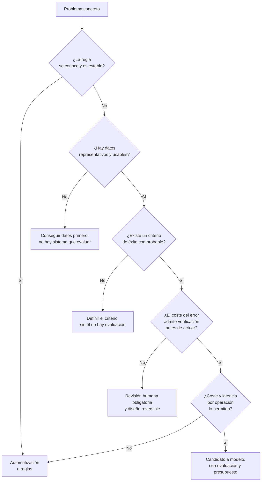

# Dónde no hace falta inteligencia artificial

> Versión en inglés: [`05-donde-no-hace-falta-ia.en.md`](05-donde-no-hace-falta-ia.en.md), traducción de esta revisión.

Esta es la página más rentable de la etapa, y va a contracorriente de casi todo lo que se lee sobre el tema. Elegir bien un modelo ahorra tiempo; descartar un sistema que no hacía falta ahorra un coste todos los meses, una superficie de fallo nueva y una discusión periódica sobre por qué el resultado cambia.

Piense en el taller de carreras. Cada temporada alguien propone tres cosas «con inteligencia artificial»: cuadrar los albaranes de las piezas, decidir cuántos juegos de gomas cargar en el camión y redactar el informe que se le manda al cliente después de cada carrera. Las tres suenan igual y las tres son casos completamente distintos. Una se resuelve con una consulta, la segunda probablemente sí pide un modelo y la tercera es un asistente con revisión humana. Poner el mismo sistema en las tres es lo que en este material se llama **agentificación forzada**: meter un modelo delante de un procedimiento que ya funcionaba. Ocurre por dos caminos: por presión comercial —hay que ofrecer algo con inteligencia artificial— y por comodidad técnica, porque montar un agente entretiene más que leer un procedimiento y automatizarlo.

## Ocho condiciones que descartan un modelo

Cada una de estas condiciones, por sí sola, basta para no usar un modelo generativo como pieza principal. Están escritas como cosas que se pueden comprobar, no como opiniones.

1. **La regla se conoce y es estable.** Si el procedimiento se puede escribir en condiciones, y esas condiciones cambian rara vez, la automatización es más rápida, más barata y auditable. Cuadrar un albarán es de este grupo: referencia, cantidad y precio.
2. **Se exige determinismo.** Facturación, nómina, cálculo de plazos, numeración de documentos. La misma entrada tiene que producir exactamente la misma salida, y eso un modelo no lo garantiza.
3. **Se exige exactitud numérica.** Aritmética, contabilidad, agregaciones, buscar un valor concreto. Un modelo de lenguaje produce texto plausible; para contar hay calculadora, hoja de cálculo o una consulta.
4. **El coste del error es alto y no se puede verificar antes de actuar.** Un pago, un diagnóstico, un borrado, un cambio en producción. Eso exige supervisión humana y un camino de vuelta, no un modelo más capaz.
5. **El volumen no compensa lo que cuesta construirlo y mantenerlo.** Por debajo de unos cientos de casos al mes con criterio variable, una persona entrenada suele salir más barata: hay que construir el sistema, evaluarlo, mantenerlo y pagar cada uso.
6. **No hay datos, o no se pueden usar.** Sin ejemplos representativos no hay evaluación posible, y sin evaluación nadie puede decir si el sistema funciona. Añádase la restricción legal o contractual sobre los datos que saldrían hacia un proveedor externo.
7. **El problema no es del modelo, sino de los datos, de la integración o del proceso.** Si el repuesto está en dos sistemas que no se hablan, o si nadie sabe hoy quién decide qué, ningún modelo arregla eso. Es el diagnóstico más caro de todos: se construye un sistema alrededor de un proceso que no estaba definido.
8. **La latencia o el coste por operación no lo permiten.** Tiempo real estricto, millones de operaciones al día o un coste por debajo del céntimo: un modelo por operación rara vez encaja.

## Qué se usa en su lugar

| Si lo que manda es… | La alternativa razonable es… |
|:--|:--|
| Una regla conocida y estable | Reglas de negocio, validaciones, un flujo escrito o una función |
| Determinismo y trazabilidad | Código determinista con registro de decisiones; revisión por excepción |
| Exactitud numérica | Hoja de cálculo, consulta a base de datos o servicio de cálculo |
| Recuperar un dato concreto | Un índice de búsqueda, una expresión regular o una consulta directa |
| Decidir entre opciones con restricciones | Optimización clásica o un solucionador, no un modelo generativo |
| Predecir un número con datos históricos | Estadística clásica o un modelo pequeño y medido; muchas veces basta |
| Clasificar con etiquetas conocidas | Un clasificador entrenado, evaluado con falsos positivos y negativos por separado |
| Tareas mecánicas en pantallas | Automatización de procesos, con sus límites documentados |
| Criterio variable y volumen bajo | Una persona con una lista de comprobación |
| Todo lo anterior con texto alrededor | Un modelo como apoyo, con revisión humana y salida verificable |

## Cómo se decide

La secuencia siguiente no pretende ser exhaustiva; está pensada para descartar rápido, que es lo que hace falta la mayoría de las veces.

Conviene acompañar el recorrido con una cuenta elemental, hecha con números propios y no estimados: cuánto cuesta construirlo, cuánto evaluarlo, cuánto cada uso, cuánto revisar los errores que cometa y cuánto cuesta hoy el proceso tal como está. En la Etapa 1 (Uso profesional, en preparación) se desarrolla ese cálculo. Aquí basta con una regla: una cifra sin origen no sirve para decidir.

## Lo que cuesta la agentificación forzada

Poner un modelo donde había un procedimiento que funcionaba tiene consecuencias concretas, todas previsibles:

- **Coste variable y difícil de presupuestar.** Se paga por uso, y el uso depende de lo que se escriba. Un coste que crece con la conversación no se parece a un coste de infraestructura.
- **Latencia.** Cada operación pasa a tardar segundos en lugar de milisegundos.
- **No determinismo.** Dos ejecuciones iguales pueden diferir, y con ellas se pierde la capacidad de reproducir una incidencia.
- **Superficie de fallo nueva.** Aparecen errores plausibles: salidas mal formadas, acciones repetidas, bucles. Son más difíciles de detectar que una excepción.
- **Dependencia de proveedor.** El comportamiento depende de un servicio ajeno, de su versión y de sus condiciones.
- **Evaluación pendiente para siempre.** Sin criterio de éxito escrito, nadie podrá afirmar que el cambio mejoró nada.
- **Pérdida de comprensión del proceso.** Cuando el procedimiento vive dentro de una petición, el equipo deja de poder explicar por qué el sistema hizo lo que hizo.

La literatura de ingeniería es explícita en los dos puntos que más se ignoran: que un sistema de aprendizaje automático es una parte pequeña de un sistema mayor, y que la deuda se acumula sobre todo alrededor del modelo, no dentro de él.

## Los tropiezos de siempre

- **Empezar por la tecnología.** El orden útil es el contrario: primero el proceso, después el criterio de éxito y solo entonces la técnica.
- **Confundir una demostración con una evaluación.** Una demostración elige los casos; una evaluación los elige antes de saber qué va a pasar con ellos.
- **Justificar la decisión con la existencia de una herramienta.** Que haya un producto que lo haga no significa que sea el camino más corto ni el más barato.
- **Sustituir un sistema que funciona.** Si el proceso actual cumple y su coste se conoce, la carga de la prueba la tiene quien propone cambiarlo.
- **Leer esta página al revés.** Aquí no se dice «no uses inteligencia artificial»: se dice que hay que poder justificar por qué se usa, con el coste y el fallo previstos por escrito.

## Cuándo no aplica

Las condiciones anteriores sirven para descartar, no para prohibir. Hay combinaciones que funcionan bien y son frecuentes: un modelo que propone y una regla que valida; un clasificador que filtra y una persona que decide; un modelo que redacta a partir de datos obtenidos por consulta. La mezcla se elige igual que el resto: por el fallo que previene cada pieza.

Tampoco sirve esta página como argumento de venta ni en contra. Una decisión así se sostiene con los números del caso concreto —volumen, coste, coste del error—, y esos no se pueden tomar prestados de una página genérica. La [práctica de la etapa](practica.md) consiste precisamente en hacer ese ejercicio sobre tres procesos propios.

## Definiciones

- **Agentificación forzada**: uso de un sistema con modelo donde bastaba un procedimiento escrito, sin justificación de coste ni de fallo previsto.
- **Criterio de descarte**: condición comprobable que, si se cumple, excluye el uso de un modelo como pieza principal.
- **Coste por operación**: coste total de resolver un caso, incluido el gasto de revisar y corregir los errores del sistema.
- **Reversibilidad**: propiedad de una acción que se puede deshacer sin consecuencias; condiciona si puede ejecutarla un sistema autónomo.
- **Sistema híbrido**: combinación de reglas, modelos y revisión humana, cada pieza con una función y un límite declarados.
- **Deuda técnica de sistemas de aprendizaje**: coste acumulado en lo que rodea al modelo —datos, configuración, integración, evaluación— más que en el modelo mismo.

## Referencias

- *Rules of Machine Learning: Best Practices for ML Engineering* — M. Zinkevich, Google — <https://developers.google.com/machine-learning/guides/rules-of-ml> (consultado 2026-10-10)
- *Hidden Technical Debt in Machine Learning Systems* — D. Sculley y otros, NIPS 2015 — <https://papers.nips.cc/paper_files/paper/2015/hash/86df7dcfd896fcaf2674f757a2463eba-Abstract.html> (consultado 2026-10-10)
- *Artificial Intelligence Risk Management Framework (AI RMF 1.0)* — NIST, 2023 — <https://doi.org/10.6028/NIST.AI.100-1> (consultado 2026-10-10)
- *Building effective agents* — Anthropic, 2024 (insiste en empezar por la solución más simple y añadir complejidad solo cuando está justificada) — <https://www.anthropic.com/engineering/building-effective-agents> (consultado 2026-10-10)
- Comprobación propia — las direcciones anteriores devolvieron código 200 en una petición HTTP el 2026-10-10

## Continuar

- Anterior: [Qué es y qué no es un agente](04-que-es-y-que-no-es-un-agente.md)
- Siguiente: [El oficio en 2026](06-el-oficio-en-2026.md)
- Práctica de la etapa: [Análisis de tres procesos propios](practica.md)
- Índice de la etapa: [Etapa 0 — Fundamentos](README.md)
- Índice temático: [`../../INDEX.md`](../../INDEX.md)

---

*Pepe, asistido por IA. Última revisión: 2026-10-10.*
